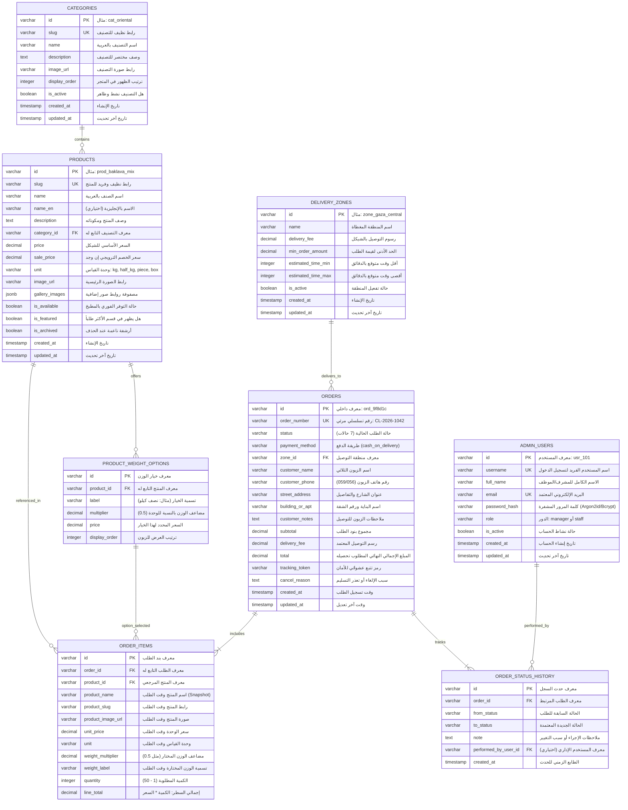

# مخطط الكيانات والعلاقات (Candy Loz Database ERD)

**المشروع:** متجر حلويات كاندي لوز (Candy Loz E-Commerce)  
**المرجع:** `PRD_v0.2.md` و `API.md` و `src/types/index.ts`  
**محرك قاعدة البيانات المقترح:** PostgreSQL 15+ (أو أي محرك علائقي يدعم معايير ANSI SQL و JSONB)  
**تاريخ التوثيق:** نوفمبر 2026  
**الإصدار:** 1.0.0  

---

## 1. نظرة عامة وفلسفة التصميم (Architecture & Design Principles)

صُمم مخطط قاعدة البيانات لمتجر **كاندي لوز** بالاعتماد على نموذج علائقي (Relational Data Model) منقح ومطابق للمستوى الثالث من المعايرة (3NF) لضمان:
1. **النزاهة المرجعية الكاملة (Referential Integrity):** تطبيق مفاتيح خارجية (Foreign Keys) صارمة مع تقييد الحذف (`ON DELETE RESTRICT`) لمنع فقدان البيانات التاريخية.
2. **عزل وتجميد الأسعار التاريخية (Historical Price Snapshot):** حفظ اسم المنتج، وسعره، ووزنه في جدول `order_items` وقت إتمام الطلب لتفادي تأثر السجلات المالية بأي تعديل مستقبلي على الكتالوج (قاعدة `BR-009`).
3. **أمان وخصوصية تتبع الطلبات (Privacy-First Tracking):** اعتماد فهرس مركب على `(order_number, customer_phone)` مع رمز أمان عشوائي `tracking_token` للتحقق الآمن دون كشف بيانات الزبائن (قاعدة `BR-010`).
4. **سجل تدقيق كامل للعمليات (Audit Trail / Timeline):** تسجيل كل انتقال لحالة الطلب عبر جدول منفصل `order_status_history` يوثق هوية الموظف المنفذ، والوقت الدقيق، وملاحظات أو أسباب الإلغاء/التعذر (قاعدة `BR-004`).
5. **الطلب كزائر (Guest Checkout):** عدم إلزام الزبائن بالتسجيل المسبق (قاعدة `FR-026` و `D-003`).

---

## 2. المخطط البياني للكيانات والعلاقات (Mermaid ERD)



---

## 3. قاموس البيانات التفصيلي (Data Dictionary)

### 3.1 جدول المستخدمين الإداريين (`admin_users`)
يخزن بيانات موظفي التشغيل والمدراء المخولين بالدخول للوحة التحكم وفق القسم 4 من `API.md`.

| اسم الحقل (Column) | نوع البيانات (Data Type) | القيود (Constraints) | الوصف والشروط |
|---|---|---|---|
| `id` | `VARCHAR(64)` | `PRIMARY KEY` | المعرف الفريد للحساب (مثل `usr_101`). |
| `username` | `VARCHAR(50)` | `UNIQUE`, `NOT NULL` | اسم المستخدم للدخول (3 أحرف على الأقل، حروف وأرقام). |
| `full_name` | `VARCHAR(100)` | `NOT NULL` | الاسم الكامل للموظف/المدير باللغة العربية. |
| `email` | `VARCHAR(150)` | `UNIQUE`, `NOT NULL` | البريد الإلكتروني للتواصل والإشعارات واستعادة الحساب. |
| `password_hash` | `VARCHAR(255)` | `NOT NULL` | تجزئة كلمة المرور المشفرة بأمان (`NFR-012`). |
| `role` | `VARCHAR(20)` | `NOT NULL`, `CHECK (role IN ('staff', 'manager'))` | دور المستخدم والصلاحيات الممنوحة (`FR-025`). |
| `is_active` | `BOOLEAN` | `NOT NULL DEFAULT TRUE` | حالة تفعيل الحساب أو تجميده (`FR-031`). |
| `created_at` | `TIMESTAMP WITH TIME ZONE` | `NOT NULL DEFAULT CURRENT_TIMESTAMP` | وقت إنشاء الحساب (UTC). |
| `updated_at` | `TIMESTAMP WITH TIME ZONE` | `NOT NULL DEFAULT CURRENT_TIMESTAMP` | وقت آخر تعديل على الحساب. |

---

### 3.2 جدول التصنيفات (`categories`)
يخزن تصنيفات المنتجات المعروضة في واجهة المتجر (القسم 3.1 في `API.md`).

| اسم الحقل (Column) | نوع البيانات (Data Type) | القيود (Constraints) | الوصف والشروط |
|---|---|---|---|
| `id` | `VARCHAR(64)` | `PRIMARY KEY` | المعرف الفريد للتصنيف (مثل `cat_oriental`). |
| `slug` | `VARCHAR(100)` | `UNIQUE`, `NOT NULL` | معرّف الرابط اللطيف (Slug) للتصفح السريع. |
| `name` | `VARCHAR(100)` | `NOT NULL` | اسم التصنيف بالعربية (مثل: "حلويات شرقية"). |
| `description` | `TEXT` | `NULL` | نبذة توضيحية عن محتوى التصنيف. |
| `image_url` | `VARCHAR(500)` | `NOT NULL` | رابط صورة الغلاف للتصنيف. |
| `display_order` | `INTEGER` | `NOT NULL DEFAULT 0` | ترتيب ظهور التصنيف في شريط التصفح والواجهة. |
| `is_active` | `BOOLEAN` | `NOT NULL DEFAULT TRUE` | هل التصنيف نشط ومعروض للزبائن. |
| `created_at` | `TIMESTAMP WITH TIME ZONE` | `NOT NULL DEFAULT CURRENT_TIMESTAMP` | تاريخ الإنشاء. |
| `updated_at` | `TIMESTAMP WITH TIME ZONE` | `NOT NULL DEFAULT CURRENT_TIMESTAMP` | تاريخ آخر تحديث. |

---

### 3.3 جدول المنتجات (`products`)
يحتوي على كافة أصناف الحلويات والأسعار الأساسية وحالات توفرها وإدارتها (القسم 3.2 و 4.3 في `API.md`).

| اسم الحقل (Column) | نوع البيانات (Data Type) | القيود (Constraints) | الوصف والشروط |
|---|---|---|---|
| `id` | `VARCHAR(64)` | `PRIMARY KEY` | المعرف الفريد للمنتج (مثل `prod_baklava_mix`). |
| `slug` | `VARCHAR(150)` | `UNIQUE`, `NOT NULL` | رابط المنتج الفريد (Regex: `/^[a-z0-9]+(?:-[a-z0-9]+)*$/`). |
| `name` | `VARCHAR(150)` | `NOT NULL` | اسم الصنف التجاري بالعربية (3 - 100 حرف). |
| `name_en` | `VARCHAR(150)` | `NULL` | الاسم الإنجليزي للمنتج (اختياري). |
| `description` | `TEXT` | `NOT NULL` | وصف تفصيلي للمنتج، المكونات ومسببات الحساسية. |
| `category_id` | `VARCHAR(64)` | `NOT NULL`, `FOREIGN KEY REFERENCES categories(id) ON DELETE RESTRICT` | التصنيف التابع له الصنف. |
| `price` | `DECIMAL(10,2)` | `NOT NULL`, `CHECK (price > 0)` | السعر الأساسي للوحدة بالشيكل الفلسطيني (`ILS`). |
| `sale_price` | `DECIMAL(10,2)` | `NULL`, `CHECK (sale_price IS NULL OR (sale_price > 0 AND sale_price < price))` | سعر الخصم الترويجي إن وجد. |
| `unit` | `VARCHAR(20)` | `NOT NULL`, `CHECK (unit IN ('kg', 'half_kg', 'piece', 'box'))` | وحدة القياس والبيع الأساسية. |
| `image_url` | `VARCHAR(500)` | `NOT NULL` | الصورة الرئيسية عالية الجودة للصنف. |
| `gallery_images` | `JSONB` | `NOT NULL DEFAULT '[]'::jsonb` | مصفوفة روابط صور إضافية لعرض المنتج. |
| `is_available` | `BOOLEAN` | `NOT NULL DEFAULT TRUE` | التوفر الفوري بالمطبخ، قابل للتبديل السريع من الموظف (`FR-022`). |
| `is_featured` | `BOOLEAN` | `NOT NULL DEFAULT FALSE` | وسم المنتجات الأكثر طلباً لتمييزها بالرئيسية. |
| `is_archived` | `BOOLEAN` | `NOT NULL DEFAULT FALSE` | الأرشفة الناعمة للمنتج لمنع الحذف الفيزيائي عند وجود طلبات تاريخية (`BR-009`). |
| `created_at` | `TIMESTAMP WITH TIME ZONE` | `NOT NULL DEFAULT CURRENT_TIMESTAMP` | وقت إنشاء المنتج. |
| `updated_at` | `TIMESTAMP WITH TIME ZONE` | `NOT NULL DEFAULT CURRENT_TIMESTAMP` | وقت آخر تحديث لبيانات المنتج. |

---

### 3.4 جدول خيارات أوزان المنتجات (`product_weight_options`)
يدعم تسعير المنتجات المباعة بالأوزان المختلفة (مثل: نصف كيلو، كيلو كامل، إلخ) وفق متطلبات `API.md` قسم 3.2.

| اسم الحقل (Column) | نوع البيانات (Data Type) | القيود (Constraints) | الوصف والشروط |
|---|---|---|---|
| `id` | `VARCHAR(64)` | `PRIMARY KEY` | المعرف الفريد لخيار الوزن. |
| `product_id` | `VARCHAR(64)` | `NOT NULL`, `FOREIGN KEY REFERENCES products(id) ON DELETE CASCADE` | المنتج التابع له خيار الوزن. |
| `label` | `VARCHAR(50)` | `NOT NULL` | التسمية المعروضة للزبون (مثل: "نصف كيلو"، "كيلو كامل"). |
| `multiplier` | `DECIMAL(4,2)` | `NOT NULL`, `CHECK (multiplier > 0)` | مضاعف الحجم أو الوزن (مثل 0.5 للـ 500 جرام، 1.0 للـ 1 كجم). |
| `price` | `DECIMAL(10,2)` | `NOT NULL`, `CHECK (price > 0)` | السعر المحتسب المحدد لهذا الخيار بالشيكل. |
| `display_order` | `INTEGER` | `NOT NULL DEFAULT 0` | ترتيب ظهور الخيارات في واجهة تفاصيل المنتج. |

---

### 3.5 جدول مناطق التوصيل (`delivery_zones`)
يحدد النطاق الجغرافي للتوصيل، الرسوم، والحد الأدنى للطلبات وفق القسم 3.4 و 4.4 في `API.md`.

| اسم الحقل (Column) | نوع البيانات (Data Type) | القيود (Constraints) | الوصف والشروط |
|---|---|---|---|
| `id` | `VARCHAR(64)` | `PRIMARY KEY` | معرف المنطقة (مثل `zone_gaza_central`). |
| `name` | `VARCHAR(150)` | `NOT NULL` | اسم المنطقة والأحياء المغطاة (مثل: "مدينة غزة - الرمال والنصر"). |
| `delivery_fee` | `DECIMAL(10,2)` | `NOT NULL DEFAULT 0.00`, `CHECK (delivery_fee >= 0)` | رسوم التوصيل بالشيكل (`ILS`). |
| `min_order_amount` | `DECIMAL(10,2)` | `NOT NULL DEFAULT 0.00`, `CHECK (min_order_amount >= 0)` | الحد الأدنى للطلب المسموح به لهذه المنطقة (`FR-015`). |
| `estimated_time_min` | `INTEGER` | `NOT NULL`, `CHECK (estimated_time_min >= 5)` | الحد الأدنى لوقت التوصيل التقديري بالدقائق. |
| `estimated_time_max` | `INTEGER` | `NOT NULL`, `CHECK (estimated_time_max >= estimated_time_min)` | الحد الأقصى لوقت التوصيل التقديري بالدقائق. |
| `is_active` | `BOOLEAN` | `NOT NULL DEFAULT TRUE` | تفعيل التوصيل للمنطقة أو إيقافه مؤقتاً (`BR-006`). |
| `created_at` | `TIMESTAMP WITH TIME ZONE` | `NOT NULL DEFAULT CURRENT_TIMESTAMP` | تاريخ الإنشاء. |
| `updated_at` | `TIMESTAMP WITH TIME ZONE` | `NOT NULL DEFAULT CURRENT_TIMESTAMP` | تاريخ آخر تحديث. |

---

### 3.6 جدول الطلبات (`orders`)
الكيان المركزي لمعالجة طلبات الشراء كزوار (Guest Orders) وإدارة دورة حياتها (القسم 3.5 و 4.2 في `API.md`).

| اسم الحقل (Column) | نوع البيانات (Data Type) | القيود (Constraints) | الوصف والشروط |
|---|---|---|---|
| `id` | `VARCHAR(64)` | `PRIMARY KEY` | المعرف الفريد الداخلي للطلب (مثل `ord_9f8d1c`). |
| `order_number` | `VARCHAR(50)` | `UNIQUE`, `NOT NULL` | رقم الطلب المرجعي للزبون (نمط: `CL-YYYY-NNNN`). |
| `status` | `VARCHAR(30)` | `NOT NULL DEFAULT 'new'`, `CHECK (status IN ('new', 'accepted', 'in_preparation', 'out_for_delivery', 'delivered', 'undelivered', 'cancelled'))` | حالة الطلب الرسمية المعتمدة وفق مصفوفة الحالات السبع (`BR-004`). |
| `payment_method` | `VARCHAR(30)` | `NOT NULL DEFAULT 'cash_on_delivery'`, `CHECK (payment_method = 'cash_on_delivery')` | طريقة الدفع المعتمدة (الدفع نقداً عند الاستلام فقط وفق نطاق MVP). |
| `zone_id` | `VARCHAR(64)` | `NOT NULL`, `FOREIGN KEY REFERENCES delivery_zones(id) ON DELETE RESTRICT` | منطقة التوصيل المختارة لحساب الرسوم والتسليم. |
| `customer_name` | `VARCHAR(100)` | `NOT NULL` | اسم الزبون الثلاثي (3 - 100 حرف). |
| `customer_phone` | `VARCHAR(20)` | `NOT NULL`, `CHECK (customer_phone ~ '^(059|056)[0-9]{7}$')` | رقم هاتف الزبون الخلوي في فلسطين (جوال أو أوريدو). |
| `street_address` | `VARCHAR(250)` | `NOT NULL` | العنوان التفصيلي للشارع والمعالم القريبة (5 - 200 حرف). |
| `building_or_apt` | `VARCHAR(100)` | `NULL` | تفاصيل البناية، رقم الطابق أو الشقة. |
| `customer_notes` | `TEXT` | `NULL` | ملاحظات الزبون الإضافية للمطبخ أو مندوب التوصيل. |
| `subtotal` | `DECIMAL(10,2)` | `NOT NULL`, `CHECK (subtotal >= 0)` | مجموع أسعار بنود الطلب الإجمالية. |
| `delivery_fee` | `DECIMAL(10,2)` | `NOT NULL`, `CHECK (delivery_fee >= 0)` | رسم التوصيل المطبق وقت تقديم الطلب. |
| `total` | `DECIMAL(10,2)` | `NOT NULL`, `CHECK (total = subtotal + delivery_fee)` | المبلغ الإجمالي النهائي المطلوب دفعه نقداً. |
| `tracking_token` | `VARCHAR(128)` | `NULL` | رمز تشفير/تتبع عشوائي للزائر لحماية استعلامات التتبع (`BR-010`). |
| `cancel_reason` | `TEXT` | `NULL` | سبب الإلغاء أو سبب تعذر التسليم (إلزامي في حالتي `cancelled` أو `undelivered`). |
| `created_at` | `TIMESTAMP WITH TIME ZONE` | `NOT NULL DEFAULT CURRENT_TIMESTAMP` | وقت تسجيل الطلب في النظام. |
| `updated_at` | `TIMESTAMP WITH TIME ZONE` | `NOT NULL DEFAULT CURRENT_TIMESTAMP` | وقت آخر تحديث لحالة أو بيانات الطلب. |

---

### 3.7 جدول بنود الطلب (`order_items`)
يخزن تفاصيل كل صنف في الطلب كـ **لقطة مجمدة تاريخياً (Data Snapshot)** لمنع تأثر الطلبات السابقة بأي تعديل مستقبلي للأسعار أو المنتجات (قاعدة `BR-009`).

| اسم الحقل (Column) | نوع البيانات (Data Type) | القيود (Constraints) | الوصف والشروط |
|---|---|---|---|
| `id` | `VARCHAR(64)` | `PRIMARY KEY` | المعرف الفريد لبند الطلب. |
| `order_id` | `VARCHAR(64)` | `NOT NULL`, `FOREIGN KEY REFERENCES orders(id) ON DELETE CASCADE` | الطلب التابع له هذا البند. |
| `product_id` | `VARCHAR(64)` | `NOT NULL`, `FOREIGN KEY REFERENCES products(id) ON DELETE RESTRICT` | المنتج المرجعي في الكتالوج. |
| `product_name` | `VARCHAR(150)` | `NOT NULL` | اسم المنتج وقت الطلب (Snapshot). |
| `product_slug` | `VARCHAR(150)` | `NOT NULL` | رابط المنتج وقت الشراء. |
| `product_image_url` | `VARCHAR(500)` | `NOT NULL` | صورة الصنف وقت الشراء. |
| `unit_price` | `DECIMAL(10,2)` | `NOT NULL`, `CHECK (unit_price > 0)` | سعر الوحدة أو الخيار المعتمد وقت الطلب (Snapshot). |
| `unit` | `VARCHAR(20)` | `NOT NULL` | وحدة القياس (kg, box, piece). |
| `weight_multiplier` | `DECIMAL(4,2)` | `NULL`, `CHECK (weight_multiplier IS NULL OR weight_multiplier > 0)` | مضاعف الوزن المختار (مثل 0.5 أو 1.0). |
| `weight_label` | `VARCHAR(50)` | `NULL` | تسمية الوزن وقت الشراء (مثل: "نصف كيلو"). |
| `quantity` | `INTEGER` | `NOT NULL`, `CHECK (quantity >= 1 AND quantity <= 50)` | الكمية المطلوبة من الصنف. |
| `line_total` | `DECIMAL(10,2)` | `NOT NULL`, `CHECK (line_total = unit_price * quantity)` | الإجمالي للسطر بالشيكل. |

---

### 3.8 جدول سجل أحداث وتتبع حالة الطلب (`order_status_history`)
يوثق كل حركة وتغيير لحالة الطلب لإنشاء الخط الزمني (Timeline) المعروض للزبون والمشرف، ويعمل كسجل تدقيق أمني (Audit Trail) وفق متطلبات `FR-017` و `FR-020` و `NFR-019`.

| اسم الحقل (Column) | نوع البيانات (Data Type) | القيود (Constraints) | الوصف والشروط |
|---|---|---|---|
| `id` | `VARCHAR(64)` | `PRIMARY KEY` | المعرف الفريد للحدث في السجل. |
| `order_id` | `VARCHAR(64)` | `NOT NULL`, `FOREIGN KEY REFERENCES orders(id) ON DELETE CASCADE` | الطلب المرتبط بهذا الحدث. |
| `from_status` | `VARCHAR(30)` | `NULL` | الحالة التي كان عليها الطلب قبل التعديل (أو `NULL` عند الإنشاء الأولي). |
| `to_status` | `VARCHAR(30)` | `NOT NULL` | الحالة الجديدة التي انتقل إليها الطلب. |
| `note` | `TEXT` | `NULL` | ملاحظة حول الإجراء (مثل سبب الإلغاء أو سبب تعذر التسليم). |
| `performed_by_user_id` | `VARCHAR(64)` | `NULL`, `FOREIGN KEY REFERENCES admin_users(id) ON DELETE SET NULL` | معرف الموظف القائم بالإجراء (يكون `NULL` إذا كان الإجراء من العميل عند إنشاء الطلب). |
| `created_at` | `TIMESTAMP WITH TIME ZONE` | `NOT NULL DEFAULT CURRENT_TIMESTAMP` | وقت حدوث الانتقال بالثانية وتوقيت UTC. |

---

## 4. مصفوفة العلاقات والروابط (Cardinality & Foreign Keys)

| الكيان المصدر (Parent) | الكيان المرتبط (Child) | نوع العلاقة (Cardinality) | المفتاح الخارجي (Foreign Key) | سياسة الحذف (On Delete) | التبرير وقواعد العمل |
|---|---|---|---|---|---|
| `categories` | `products` | 1 إلى متعدد (`1:N`) | `products.category_id` | `RESTRICT` | منع حذف أي تصنيف طالما توجد أصناف مرتبطة به. |
| `products` | `product_weight_options` | 1 إلى متعدد (`1:N`) | `product_weight_options.product_id` | `CASCADE` | حذف خيارات الأوزان تلقائياً في حال حذف مسودة الصنف (قبل طلبه). |
| `products` | `order_items` | 1 إلى متعدد (`1:N`) | `order_items.product_id` | `RESTRICT` | **قاعدة BR-009:** منع الحذف الفيزيائي لأي منتج له طلبات تاريخية (يتم استخدام `is_archived`). |
| `delivery_zones` | `orders` | 1 إلى متعدد (`1:N`) | `orders.zone_id` | `RESTRICT` | منع حذف مناطق التوصيل التي تحتوي على طلبات، بل يتم تعطيلها عبر `is_active = FALSE`. |
| `orders` | `order_items` | 1 إلى متعدد (`1:N`) | `order_items.order_id` | `CASCADE` | بنود الطلب تابعة للطلب بشكل كامل. |
| `orders` | `order_status_history` | 1 إلى متعدد (`1:N`) | `order_status_history.order_id` | `CASCADE` | سجل التتبع تابع للطلب بالكامل. |
| `admin_users` | `order_status_history` | 1 إلى متعدد (`1:N`) | `order_status_history.performed_by_user_id` | `SET NULL` | الحفاظ على سجل تدقيق حالة الطلب حتى لو تم حذف حساب الموظف في المستقبل. |

---

## 5. قواعد العمل وقيود النزاهة في قاعدة البيانات (Business Rules Mapping)

| كود القاعدة | الوصف في PRD / API | آلية التطبيق في قاعدة البيانات (Database Enforcement) |
|---|---|---|
| **BR-001** | منع إضافة أو طلب منتج غير متوفر. | فحص برمجي عند الطلب، مع وجود مؤشر `is_available = TRUE` في جدول `products`. |
| **BR-004** | دورة حالات الطلب السبعة الصارمة. | عمود `orders.status` مقيد بـ `CHECK (status IN ('new', 'accepted', 'in_preparation', 'out_for_delivery', 'delivered', 'undelivered', 'cancelled'))`. يتم التحقق من جدول الانتقالات `ALLOWED_STATUS_TRANSITIONS` عبر طبقة الـ Service أو Database Triggers. |
| **BR-006** | منع الطلبات لمناطق خارج التغطية. | ربط إلزامي عبر المفتاح الخارجي `zone_id` والتأكد من `is_active = TRUE` للمنطقة. |
| **BR-008 & FR-015** | الحد الأدنى للطلب لكل منطقة. | وجود حقل `min_order_amount` في جدول `delivery_zones` والتحقق من أن `orders.subtotal >= delivery_zones.min_order_amount`. |
| **BR-009** | الحفاظ على سلامة الطلبات السابقة وأرشفة المنتجات. | 1. تخزين لقطة سعرية ومواصفات المنتج في `order_items`.<br>2. قيد `ON DELETE RESTRICT` على `order_items.product_id`.<br>3. حقل `products.is_archived = TRUE` عند الحاجة للأرشفة. |
| **BR-010** | حماية خصوصية بيانات الزبائن أثناء التتبع. | الاستعلام المشترك المفهرس: `WHERE order_number = ? AND customer_phone = ?`، مع تشديد حماية الـ Rate Limit على الواجهة البرمجية. |
| **FR-010** | طريقة الدفع نقداً عند الاستلام. | قيد ثابت `CHECK (payment_method = 'cash_on_delivery')` في جدول `orders`. |
| **FR-018 & FR-035** | إلزامية تسجيل سبب الإلغاء أو تعذر التسليم. | شرط عند تحديث الحالة إلى `cancelled` أو `undelivered` بأن لا يكون `cancel_reason IS NULL AND LENGTH(cancel_reason) >= 5`. |
| **الهاتف الفلسطيني** | التحقق من صحة رقم الهاتف المحلي. | قيد `CHECK (customer_phone ~ '^(059|056)[0-9]{7}$')` في جدول `orders`. |

---

## 6. فهارس الأداء المقترحة (Performance Indexes)

لتحقيق أداء عالي وسرعة استجابة فائقة وفق متطلبات الأداء `NFR-002` و `NFR-008`:

```sql
-- 1. تسريع الاستعلام وتتبع الطلب برقم الطلب والهاتف (BR-010)
CREATE INDEX idx_orders_tracking ON orders (order_number, customer_phone);

-- 2. تسريع استعراض وتصفية لوحة إدارة الطلبات للموظفين حسب الحالة وتاريخ الإنشاء
CREATE INDEX idx_orders_admin_status_date ON orders (status, created_at DESC);

-- 3. تسريع تصفية واستعراض المنتجات المعروضة في واجهة المتجر حسب التصنيف والتوفر
CREATE INDEX idx_products_category_available ON products (category_id, is_available) WHERE is_archived = FALSE;

-- 4. تسريع جلب بنود الطلب وسجل الحالات
CREATE INDEX idx_order_items_order_id ON order_items (order_id);
CREATE INDEX idx_order_status_history_order_id ON order_status_history (order_id, created_at ASC);

-- 5. تسريع البحث في أسماء وسلاجات المنتجات
CREATE INDEX idx_products_slug ON products (slug);
CREATE INDEX idx_categories_slug ON categories (slug);
```

---

## 7. سكربت DDL المقترح لإنشاء الجداول (PostgreSQL DDL Reference)

```sql
-- تفعيل الامتدادات المطلوبة لتوليد المعرفات إن لزم
CREATE EXTENSION IF NOT EXISTS "uuid-ossp";

-- 1. جدول مدراء وموظفي النظام
CREATE TABLE admin_users (
    id VARCHAR(64) PRIMARY KEY,
    username VARCHAR(50) NOT NULL UNIQUE,
    full_name VARCHAR(100) NOT NULL,
    email VARCHAR(150) NOT NULL UNIQUE,
    password_hash VARCHAR(255) NOT NULL,
    role VARCHAR(20) NOT NULL CHECK (role IN ('staff', 'manager')),
    is_active BOOLEAN NOT NULL DEFAULT TRUE,
    created_at TIMESTAMP WITH TIME ZONE NOT NULL DEFAULT CURRENT_TIMESTAMP,
    updated_at TIMESTAMP WITH TIME ZONE NOT NULL DEFAULT CURRENT_TIMESTAMP
);

-- 2. جدول التصنيفات
CREATE TABLE categories (
    id VARCHAR(64) PRIMARY KEY,
    slug VARCHAR(100) NOT NULL UNIQUE,
    name VARCHAR(100) NOT NULL,
    description TEXT,
    image_url VARCHAR(500) NOT NULL,
    display_order INTEGER NOT NULL DEFAULT 0,
    is_active BOOLEAN NOT NULL DEFAULT TRUE,
    created_at TIMESTAMP WITH TIME ZONE NOT NULL DEFAULT CURRENT_TIMESTAMP,
    updated_at TIMESTAMP WITH TIME ZONE NOT NULL DEFAULT CURRENT_TIMESTAMP
);

-- 3. جدول المنتجات
CREATE TABLE products (
    id VARCHAR(64) PRIMARY KEY,
    slug VARCHAR(150) NOT NULL UNIQUE,
    name VARCHAR(150) NOT NULL,
    name_en VARCHAR(150),
    description TEXT NOT NULL,
    category_id VARCHAR(64) NOT NULL REFERENCES categories(id) ON DELETE RESTRICT,
    price DECIMAL(10,2) NOT NULL CHECK (price > 0),
    sale_price DECIMAL(10,2) CHECK (sale_price IS NULL OR (sale_price > 0 AND sale_price < price)),
    unit VARCHAR(20) NOT NULL CHECK (unit IN ('kg', 'half_kg', 'piece', 'box')),
    image_url VARCHAR(500) NOT NULL,
    gallery_images JSONB NOT NULL DEFAULT '[]'::jsonb,
    is_available BOOLEAN NOT NULL DEFAULT TRUE,
    is_featured BOOLEAN NOT NULL DEFAULT FALSE,
    is_archived BOOLEAN NOT NULL DEFAULT FALSE,
    created_at TIMESTAMP WITH TIME ZONE NOT NULL DEFAULT CURRENT_TIMESTAMP,
    updated_at TIMESTAMP WITH TIME ZONE NOT NULL DEFAULT CURRENT_TIMESTAMP
);

-- 4. جدول خيارات الأوزان
CREATE TABLE product_weight_options (
    id VARCHAR(64) PRIMARY KEY,
    product_id VARCHAR(64) NOT NULL REFERENCES products(id) ON DELETE CASCADE,
    label VARCHAR(50) NOT NULL,
    multiplier DECIMAL(4,2) NOT NULL CHECK (multiplier > 0),
    price DECIMAL(10,2) NOT NULL CHECK (price > 0),
    display_order INTEGER NOT NULL DEFAULT 0
);

-- 5. جدول مناطق التوصيل
CREATE TABLE delivery_zones (
    id VARCHAR(64) PRIMARY KEY,
    name VARCHAR(150) NOT NULL,
    delivery_fee DECIMAL(10,2) NOT NULL DEFAULT 0.00 CHECK (delivery_fee >= 0),
    min_order_amount DECIMAL(10,2) NOT NULL DEFAULT 0.00 CHECK (min_order_amount >= 0),
    estimated_time_min INTEGER NOT NULL CHECK (estimated_time_min >= 5),
    estimated_time_max INTEGER NOT NULL CHECK (estimated_time_max >= estimated_time_min),
    is_active BOOLEAN NOT NULL DEFAULT TRUE,
    created_at TIMESTAMP WITH TIME ZONE NOT NULL DEFAULT CURRENT_TIMESTAMP,
    updated_at TIMESTAMP WITH TIME ZONE NOT NULL DEFAULT CURRENT_TIMESTAMP
);

-- 6. جدول الطلبات
CREATE TABLE orders (
    id VARCHAR(64) PRIMARY KEY,
    order_number VARCHAR(50) NOT NULL UNIQUE,
    status VARCHAR(30) NOT NULL DEFAULT 'new' CHECK (status IN ('new', 'accepted', 'in_preparation', 'out_for_delivery', 'delivered', 'undelivered', 'cancelled')),
    payment_method VARCHAR(30) NOT NULL DEFAULT 'cash_on_delivery' CHECK (payment_method = 'cash_on_delivery'),
    zone_id VARCHAR(64) NOT NULL REFERENCES delivery_zones(id) ON DELETE RESTRICT,
    customer_name VARCHAR(100) NOT NULL,
    customer_phone VARCHAR(20) NOT NULL CHECK (customer_phone ~ '^(059|056)[0-9]{7}$'),
    street_address VARCHAR(250) NOT NULL,
    building_or_apt VARCHAR(100),
    customer_notes TEXT,
    subtotal DECIMAL(10,2) NOT NULL CHECK (subtotal >= 0),
    delivery_fee DECIMAL(10,2) NOT NULL CHECK (delivery_fee >= 0),
    total DECIMAL(10,2) NOT NULL CHECK (total = subtotal + delivery_fee),
    tracking_token VARCHAR(128),
    cancel_reason TEXT,
    created_at TIMESTAMP WITH TIME ZONE NOT NULL DEFAULT CURRENT_TIMESTAMP,
    updated_at TIMESTAMP WITH TIME ZONE NOT NULL DEFAULT CURRENT_TIMESTAMP
);

-- 7. جدول بنود الطلب
CREATE TABLE order_items (
    id VARCHAR(64) PRIMARY KEY,
    order_id VARCHAR(64) NOT NULL REFERENCES orders(id) ON DELETE CASCADE,
    product_id VARCHAR(64) NOT NULL REFERENCES products(id) ON DELETE RESTRICT,
    product_name VARCHAR(150) NOT NULL,
    product_slug VARCHAR(150) NOT NULL,
    product_image_url VARCHAR(500) NOT NULL,
    unit_price DECIMAL(10,2) NOT NULL CHECK (unit_price > 0),
    unit VARCHAR(20) NOT NULL,
    weight_multiplier DECIMAL(4,2) CHECK (weight_multiplier IS NULL OR weight_multiplier > 0),
    weight_label VARCHAR(50),
    quantity INTEGER NOT NULL CHECK (quantity >= 1 AND quantity <= 50),
    line_total DECIMAL(10,2) NOT NULL CHECK (line_total = unit_price * quantity)
);

-- 8. جدول سجل تتبع وتدقيق حالات الطلب
CREATE TABLE order_status_history (
    id VARCHAR(64) PRIMARY KEY,
    order_id VARCHAR(64) NOT NULL REFERENCES orders(id) ON DELETE CASCADE,
    from_status VARCHAR(30),
    to_status VARCHAR(30) NOT NULL,
    note TEXT,
    performed_by_user_id VARCHAR(64) REFERENCES admin_users(id) ON DELETE SET NULL,
    created_at TIMESTAMP WITH TIME ZONE NOT NULL DEFAULT CURRENT_TIMESTAMP
);
```
