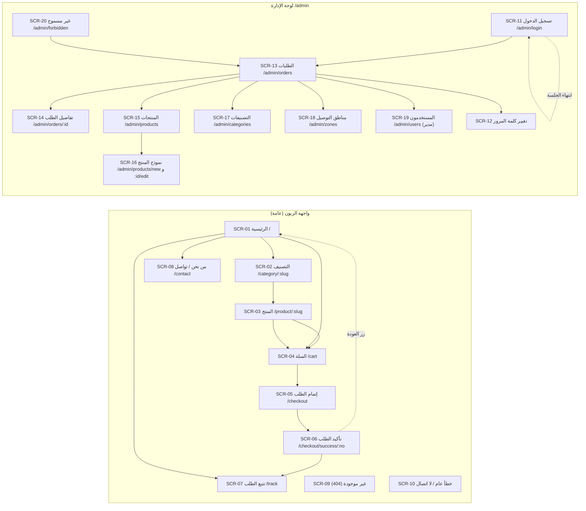
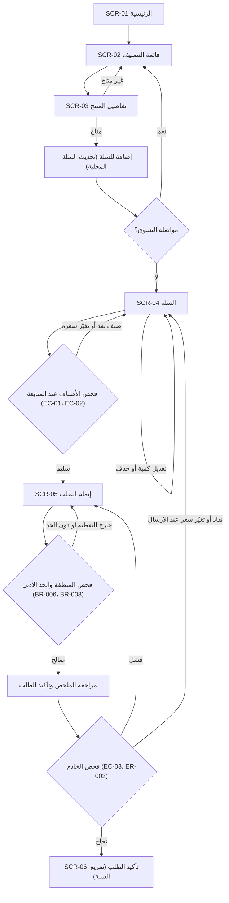
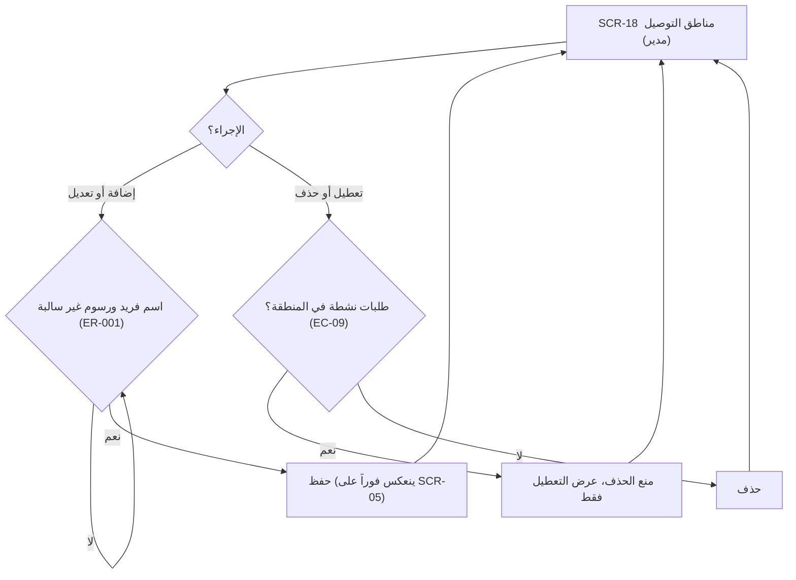
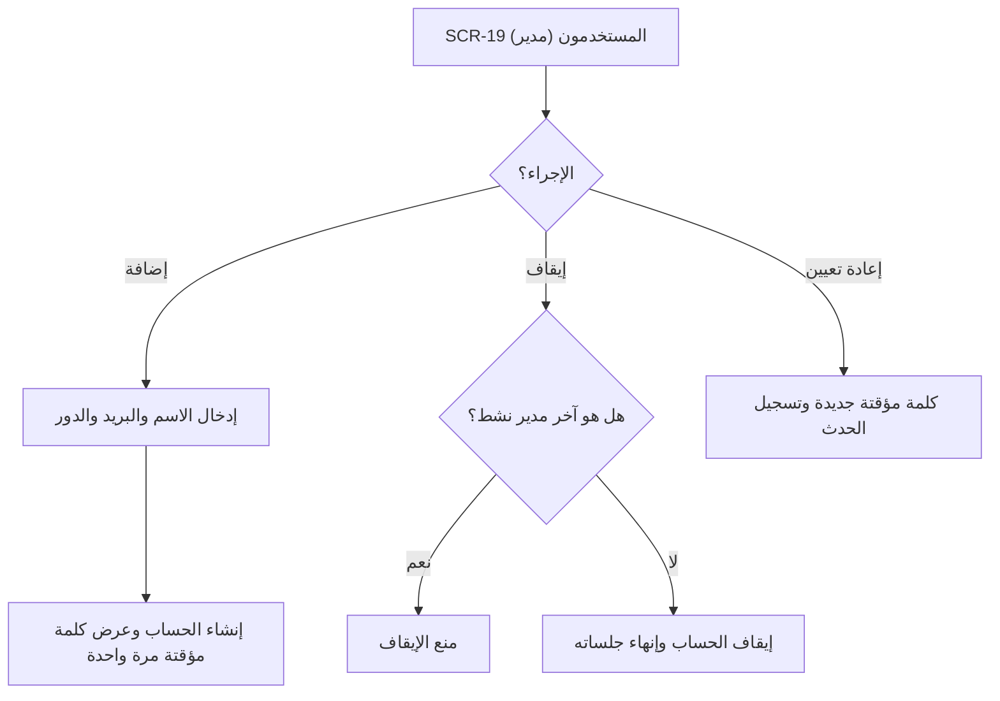
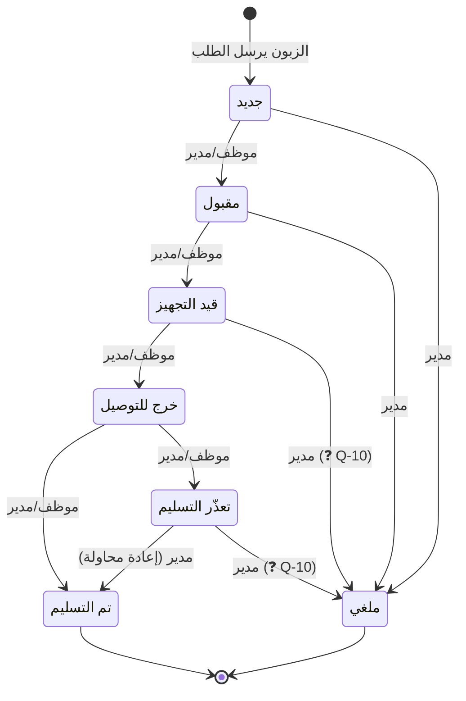

# UX Blueprint: متجر حلويات مع توصيل (MVP)

**الإصدار:** 0.1 (مسودة للمراجعة، غير معتمدة)
**التاريخ:** 27 أكتوبر 2026
**المصادر:** PRD_v0.2.md (الإصدار 0.2) و docs/user-flow.md (الإصدار 1.0)
**الملف المرافق:** [SCREEN_INVENTORY.md](SCREEN_INVENTORY.md) (الفهرس المختصر للشاشات وأولوياتها)

---

## 0. ملاحظات على المصادر والحالة

- **ملفان مطلوبان غير متوفرين في هذه البيئة:** `docs/PRD.md` و`docs/UI_UX_REQUIREMENTS.md`. استُخدم بدلهما PRD_v0.2.md (المرفق في المحادثة) و docs/user-flow.md. عند توفر الملفين يُراجع هذا البلوبرنت مقابلهما، وأي تعارض يُسجَّل في القسم 9.
- **لا يوجد تصميم شاشات في هذه الوثيقة.** كل شاشة مُوصَّفة بالغرض والمكونات والبيانات والإجراءات والحالات فقط.
- **الحالة الحاجبة:** الأسئلة Q-01 إلى Q-06 وQ-09 في PRD (المعلَّمة 🔴) ما زالت مفتوحة. نطاق MVP هنا **مقترح** ولا يُعتمد قبل حسمها. البنود المرتبطة بها موسومة **(مشروط)** وتُستبعد من البناء حتى تُحسم.
- **مصطلحات الحالات:** تُستخدم أسماء حالات الطلب من PRD 0.2 (القسم 11-ج): جديد، مقبول، قيد التجهيز، خرج للتوصيل، تم التسليم، تعذّر التسليم، ملغي. انظر البند 9 بشأن اختلاف الاسم "مؤكد" في docs/user-flow.md.

### دليل الأولوية
| الفئة | المعنى | القاعدة |
|---|---|---|
| **Core** | شاشة لا يُطلق MVP بدونها | تُبنى في الشريحة الأولى |
| **Supporting** | ضرورية للتشغيل لكن يمكن أن تأتي بعد الشاشات الأساسية داخل الإصدار نفسه | تُبنى في MVP، بعد Core |
| **Future** | خارج MVP | لا تُصمَّم ولا تُبنى ولا تُذكر في المسارات |

**وسم (مشروط):** عنصر داخل شاشة يتوقف ظهوره على سؤال مفتوح. يُبنى فقط بعد الحسم، ولا يُبنى بافتراض صامت.

---

## 1. الأدوار والتنقل

| الدور | الوصول | ملاحظة |
|---|---|---|
| زائر / زبون بلا حساب | واجهة المتجر العامة | الطلب كزائر (FR-026، مشروط بـ Q-09) |
| موظف (Staff) | لوحة الإدارة: الطلبات، توفر المنتجات | (مشروط بـ Q-04) |
| مدير (Manager) | لوحة الإدارة كاملة | يشمل الإلغاء وإدارة المنتجات والتصنيفات والمناطق والمستخدمين |

**قاعدة التنقل:** الزائر لا يرى أي رابط إداري. الموظف لا يرى الشاشات التي يملكها المدير فقط، ويحصل على 403 (SCR-20) إن كتب الرابط مباشرة. الحماية الفعلية في الخادم (NFR-013)، والإخفاء في الواجهة تحسين تجربة فقط.

---

## 2. خريطة الموقع (Sitemap)



---

## 3. رحلات MVP (Journeys)

التفاصيل الخطوة بخطوة لكل رحلة موجودة في docs/user-flow.md. هنا يُربط كل خطوة بالشاشة المسؤولة عنها، وتُضاف مسارات الخطأ التي تؤثر على تقسيم الشاشات.

### J1: الزبون يشتري بالتوصيل (Core)



**ملاحظة:** فشل الإرسال يبقي الزبون في SCR-05 مع الاحتفاظ بالبيانات والسلة (ER-002، AC-007)، وليس في صفحة مستقلة.

### J2: الزبون يتتبع طلبه (Supporting)

```mermaid
flowchart TD
    A["SCR-06 أو SCR-01 (رابط التتبع)"] --> B["SCR-07 نموذج التتبع: رقم الطلب + الهاتف"]
    B --> C{"تحقق الصيغة (ER-001)"}
    C -->|غير صالح| B
    C -->|صالح| D{"مطابقة الطلب والهاتف (BR-010)"}
    D -->|غير مطابق| E["رسالة عامة محايدة (ER-005) ويُحتسب المحاولة"]
    E --> B
    D -->|تجاوز حد المحاولات (NFR-015)| F["حجب مؤقت للاستعلام"]
    D -->|مطابق| G["عرض الحالة الحالية فقط + وقت التحديث"]
    G --> H["SCR-08 تواصل معنا (إن تعذّر الفهم)"]
```

### J3: الموظف/المدير يعالج الطلب (Core)

```mermaid
flowchart TD
    A["SCR-11 تسجيل الدخول"] --> B{"بيانات صحيحة؟ (NFR-015)"}
    B -->|لا| A
    B -->|نعم| C["SCR-13 قائمة الطلبات (الجديدة أولاً)"]
    C --> D["SCR-14 تفاصيل الطلب"]
    D --> E{"الإجراء؟"}
    E -->|انتقال مسموح (BR-004)| F["حفظ الحالة + السجل (FR-017)"]
    E -->|انتقال غير مسموح| D
    E -->|تعذّر التسليم| F
    E -->|إلغاء: مدير فقط| G{"سبب الإلغاء مكتوب؟ (FR-018)"}
    G -->|لا| G
    G -->|نعم| F
    F --> H{"تعارض تزامن؟ (EC-10، AC-009)"}
    H -->|نعم| I["رسالة تعارض + تحميل أحدث نسخة"]
    I --> D
    H -->|لا| C
    E -->|إجراء بلا صلاحية| J["SCR-20 غير مسموح (ER-007)"]
```

### J4: المدير يدير الكتالوج (Core)

```mermaid
flowchart TD
    A["SCR-15 المنتجات"] --> B{"الإجراء؟"}
    B -->|تبديل التوفر (موظف أو مدير)| C["تحديث فوري، تراجع عند الفشل (BR-001)"]
    C --> A
    B -->|إضافة أو تعديل| D["SCR-16 نموذج المنتج"]
    D --> E{"التحقق (ER-001، ER-008)"}
    E -->|خطأ| D
    E -->|سليم| F["حفظ (السعر الجديد للطلبات اللاحقة فقط، AC-006)"]
    F --> A
    B -->|أرشفة أو حذف| G{"مرتبط بطلبات سابقة؟ (BR-009)"}
    G -->|نعم| H["أرشفة بدلاً من الحذف"]
    G -->|لا| I["حذف نهائي"]
    H --> A
    I --> A
    B -->|تصنيفات| J["SCR-17 التصنيفات (مدير)"]
```

### J5: المدير يضبط مناطق التوصيل (Core)



### J6: المدير يدير حسابات الإدارة (Core، مشروط بـ Q-04)



### حالة الطلب (المرجع الملزم: PRD 0.2، القسم 11-ج)



---

## 4. مواصفات الشاشات

كل شاشة تحمل الحقول التالية: الغرض، الأدوار، المسار، المكونات، البيانات، الإجراءات، التنقل، التحقق، الحالات، إمكانية الوصول، الاستجابة. ويُختصر الحقل حين لا يختلف عن القاعدة العامة في القسم 5.

### واجهة الزبون

#### SCR-01 الرئيسية (Core)
- **الغرض:** تعريف الزبون بالمتجر وفتح التصنيفات بسرعة.
- **الأدوار:** زائر.
- **المسار:** `/`
- **المكونات:** شريط علوي (شعار، رابط التصنيفات، عدّاد السلة، رابط "تتبع طلبي")، شبكة التصنيفات، حقل بحث (Supporting، FR-003)، مؤشر حالة المتجر (❓ Q-07، مشروط)، تذييل بروابط "من نحن" و"تواصل".
- **البيانات:** التصنيفات مرتبة حسب `order` (FR-001)، عدد أصناف السلة من التخزين المحلي.
- **الإجراءات:** فتح تصنيف، البحث، فتح السلة، فتح التتبع.
- **التنقل:** SCR-02، SCR-04، SCR-07، SCR-08.
- **التحقق:** البحث يبدأ بعد حرفين (🔵).
- **الحالات:** تحميل (هيكل عظمي)، لا توجد تصنيفات (رسالة "لا توجد منتجات متاحة حالياً")، خطأ شبكة (رسالة مع إعادة المحاولة)، متجر مغلق (مشروط بـ Q-07، عرض فقط بلا منع).
- **إمكانية الوصول:** التصنيفات روابط نصية حقيقية، عدّاد السلة معلن بـ `aria-live="polite"` عند التغيير مع تسمية "عدد الأصناف في السلة".
- **الاستجابة:** عمود واحد حتى 390px، شبكة عمودين فوقه. الشريط العلوي ثابت مع احترام `safe-area`.

#### SCR-02 قائمة التصنيف (Core)
- **الغرض:** عرض منتجات تصنيف واحد للاختيار.
- **الأدوار:** زائر.
- **المسار:** `/category/:slug`
- **المكونات:** عنوان التصنيف، بطاقات المنتجات (صورة، اسم، سعر، شارة "غير متاح")، حقل بحث داخل التصنيف (Supporting، FR-003)، زر العودة.
- **البيانات:** منتجات التصنيف النشطة وغير المؤرشفة، بالحقول الواردة في FR-002.
- **الإجراءات:** فتح منتج. لا توجد إضافة سريعة من البطاقة في MVP (🔵 لتقليل أخطاء الكمية).
- **التنقل:** SCR-03، SCR-01.
- **التحقق:** لا يوجد.
- **الحالات:** تحميل، تصنيف فارغ ("لا توجد منتجات في هذا التصنيف حالياً")، منتج بلا صورة (عنصر نصي بديل، F-1)، slug غير موجود (SCR-09)، منتج نفد أثناء التصفح (تظهر الشارة عند إعادة الجلب).
- **إمكانية الوصول:** الشارة "غير متاح" نص وليس لوناً فقط، صورة كل منتج بنص بديل من حقل الوصف البديل.
- **الاستجابة:** عمودان على الجوال، ثلاثة فأكثر على الشاشات الأكبر.

#### SCR-03 تفاصيل المنتج (Core)
- **الغرض:** عرض المنتج واختيار الكمية وإضافته للسلة.
- **الأدوار:** زائر.
- **المسار:** `/product/:slug`
- **المكونات:** صورة، اسم، وصف، سعر، حالة التوفر، المكونات ومسببات الحساسية (مشروط بـ Q-17)، أداة الكمية، زر "أضف للسلة"، رابط "العودة للتصنيف"، تأكيد الإضافة مع رابط "عرض السلة".
- **البيانات:** المنتج (FR-002)، السعر الحالي من الخادم.
- **الإجراءات:** تعديل الكمية، إضافة للسلة.
- **التنقل:** SCR-04 بعد الإضافة (أو البقاء مع رابط)، SCR-02.
- **التحقق:** الكمية عدد صحيح من 1 إلى حد أعلى يحدده المالك أو ثابت (❓ يُضاف للأسئلة: حد الكمية). المنتج غير المتاح يعطّل الزر (BR-001، ER-003).
- **الحالات:** متاح، غير متاح (زر معطل مع نص السبب)، نفد للتو عند إعادة الجلب (يتعطل الزر ويظهر التنبيه)، خطأ تحميل، منتج غير موجود (SCR-09).
- **إمكانية الوصول:** أداة الكمية بأزرار مسماة ("زيادة الكمية" / "تقليل الكمية") وقيمة معلنة، الزر المعطل يذكر سببه نصاً.
- **الاستجابة:** صورة فوق المعلومات على الجوال، جنباً إلى جنب على الشاشات الأكبر. زر الإضافة ثابت أسفل الشاشة على الجوال.

#### SCR-04 السلة (Core)
- **الغرض:** مراجعة الأصناف وتعديلها قبل الدفع.
- **الأدوار:** زائر.
- **المسار:** `/cart`
- **المكونات:** قائمة الأصناف (صورة مصغرة، اسم، سعر الوحدة، أداة الكمية، زر حذف)، ملخص (المجموع الفرعي، ويُعرض مع الرسوم في SCR-05)، زر "متابعة الطلب"، زر "مواصلة التسوق".
- **البيانات:** أسطر السلة من التخزين المحلي (منتج، كمية، سعر وقت الإضافة)، ثم تُحدَّث أسعارها وتوفرها من الخادم عند الفتح (EC-01، EC-02).
- **الإجراءات:** تعديل كمية، حذف صنف، متابعة، مواصلة التسوق.
- **التنقل:** SCR-05، SCR-02، SCR-01.
- **التحقق:** الكمية ≥ 1. لا تُفعَّل "متابعة الطلب" إن وُجد صنف غير متاح، ويُطلب حذفه (EC-01). تغير السعر يُعرض بالفرق ويُطلب تأكيده (EC-02).
- **الحالات:** سلة فارغة (زر للتصفح)، جارٍ التحقق من الأسعار، تنبيه صنف نفد، تنبيه تغيّر سعر، خطأ شبكة مع الاحتفاظ بالأصناف.
- **إمكانية الوصول:** زر الحذف يحمل اسم الصنف في تسميته ("حذف {الاسم}")، تحديث الإجمالي بـ `aria-live="polite"`.
- **الاستجابة:** شريط سفلي ثابت فيه الإجمالي وزر المتابعة على الجوال.

#### SCR-05 إتمام الطلب (Core، مشروط بـ Q-06 وQ-09)
- **الغرض:** جمع بيانات التوصيل وتأكيد الطلب.
- **الأدوار:** زائر.
- **المسار:** `/checkout`
- **المكونات:**
  - نموذج: الاسم الكامل، رقم الهاتف، العنوان النصي التفصيلي، المنطقة (قائمة من SCR-18 المفعّلة).
  - (مشروط بـ Q-05) خيار "استلام من المتجر" يُخفي حقل العنوان والمنطقة والرسوم (AC-011).
  - (مشروط بـ Q-07) اختيار موعد التوصيل.
  - (مشروط بـ Q-06) طريقة الدفع. الافتراض المقترح في D-002 هو الدفع عند الاستلام، ولا يُعرض الخيار إن كانت طريقة واحدة.
  - ملخص الطلب (FR-011): الأصناف، المجموع الفرعي، رسوم المنطقة، الإجمالي، والحد الأدنى إن وُجد (مشروط بـ Q-08).
  - زر "تأكيد الطلب" مع مفتاح تكرار (idempotency key).
- **البيانات:** الزبون، العنوان، المنطقة ورسومها، السلة، طريقة الدفع (مشروط)، الحد الأدنى (مشروط).
- **الإجراءات:** اختيار المنطقة (يحدّث الرسوم)، تأكيد الطلب، الرجوع للسلة.
- **التنقل:** SCR-06 عند النجاح، SCR-04 عند تغيّر أو نفاد صنف عند الإرسال.
- **التحقق:**
  - الاسم مطلوب (🔵 حروف لا تقل عن حرفين).
  - الهاتف بصيغة صالحة (ER-001، AC-001). صيغة الأرقام الدولية والمحلية تُحسم مع Q-13.
  - العنوان النصي مطلوب، والمنطقة مطلوبة.
  - المنطقة خارج التغطية: رسالة تعرض المناطق المتاحة (ER-004، BR-006).
  - دون الحد الأدنى للمنطقة: رسالة توضح المبلغ الناقص (BR-008، مشروط بـ Q-08).
  - خارج ساعات العمل: مشروط بـ Q-07.
  - يُفحص الخادم كل شيء من جديد، والواجهة للتوجيه فقط.
- **الحالات:** جاهز، جارٍ الإرسال (الزر معطل ويظهر مؤشر، EC-03)، خطأ حقول، منطقة غير مغطاة، دون الحد الأدنى، فشل الإرسال (ER-002، يبقى النموذج والسلة كما هما ويُتاح إعادة المحاولة دون تكرار الطلب)، تغيّر أسعار أو نفاد عند الإرسال (يعود للسلة مع التنبيه).
- **إمكانية الوصول:** كل حقل له تسمية مرئية وخاصية `autocomplete` مناسبة (`name`، `tel`، `street-address`)، ملخص أخطاء في أعلى النموذج مع روابط للحقول، ينتقل التركيز لأول خطأ، حقل الهاتف `dir="ltr"`، الأخطاء مربوطة بالحقول عبر `aria-describedby`.
- **الاستجابة:** عمود واحد، والإجمالي وزر التأكيد في شريط سفلي ثابت على الجوال.

#### SCR-06 تأكيد الطلب (Core)
- **الغرض:** تأكيد الاستلام وإعطاء الزبون رقم الطلب.
- **الأدوار:** زائر.
- **المسار:** `/checkout/success/:orderNumber`
- **المكونات:** رسالة نجاح، رقم الطلب مع زر نسخ، ملخص مختصر (عدد الأصناف، الإجمالي، المنطقة، طريقة الدفع إن وُجدت)، رابط "تتبع طلبي" (Supporting)، رابط "العودة للرئيسية"، معلومات التواصل (❓ Q-15).
- **البيانات:** رقم الطلب والملخص من استجابة الإنشاء. بعد تحديث الصفحة يُعرض رقم الطلب والتعليمات فقط، بلا بيانات شخصية (BR-010).
- **الإجراءات:** نسخ الرقم، فتح التتبع، العودة للرئيسية.
- **التنقل:** SCR-07، SCR-01.
- **التحقق:** إن لم يوجد رقم طلب صالح في المسار، يُعاد التوجيه إلى SCR-01 (🔵).
- **الحالات:** نجاح (السلة فُرّغت، FR-012)، رقم فقط بعد التحديث، رقم غير صالح (إعادة توجيه).
- **إمكانية الوصول:** ينتقل التركيز إلى العنوان الرئيسي، زر النسخ يعلن النتيجة.
- **الاستجابة:** عمود واحد.

#### SCR-07 تتبع الطلب (Supporting، FR-020)
- **الغرض:** معرفة الحالة الحالية للطلب دون الاتصال بالمتجر.
- **الأدوار:** زائر (بيانات التحقق: رقم الطلب والهاتف).
- **المسار:** `/track`، ويُملأ رقم الطلب تلقائياً من `?order=` إن جاء من SCR-06.
- **المكونات:** نموذج (رقم الطلب، الهاتف)، زر "استعلام"، نتيجة: خطوات الحالة (مرتبة مع تمييز الخطوة الحالية)، وقت آخر تحديث، ملخص الأصناف دون بيانات أخرى.
- **البيانات:** الحالة الحالية، وقت التحديث، الملخص. لا يُعاد أي حقل شخصي آخر.
- **الإجراءات:** استعلام، استعلام جديد.
- **التنقل:** SCR-08، SCR-01.
- **التحقق:** الحقلان مطلوبان (ER-001)، صيغة رقم الطلب، صيغة الهاتف. المحاولات الفاشلة تُحسب، وبعد الحد يُحجب الاستعلام مؤقتاً (AC-010، NFR-015، الحد 🔵 ❓).
- **الحالات:** ابتدائية، جارٍ الاستعلام، لم يُعثر على طلب مطابق (رسالة عامة واحدة للحالتين، ER-005)، محجوب مؤقتاً، ونتيجة لكل حالة من الحالات السبع بشرح قصير. الحالة "ملغي" بسبب الإلغاء تبعاً لـ Q-10.
- **إمكانية الوصول:** الحالة تُقرأ نصاً وليس أيقونة فقط، خطوات الحالة تستخدم `aria-current="step"`.
- **الاستجابة:** عمود واحد، والنموذج أعلى النتيجة.

#### SCR-08 من نحن / تواصل (Supporting، المحتوى ❓)
- **الغرض:** تقديم المتجر وطرق التواصل.
- **الأدوار:** زائر.
- **المسار:** `/contact`
- **المكونات:** نص تعريفي، أرقام التواصل كروابط `tel:`، ساعات العمل (❓ Q-07)، رابط واتساب مباشر إن قرر المالك (❓ قناة، بدون تكامل).
- **البيانات:** محتوى ثابت من الإعدادات، بلا CMS في MVP (🔵).
- **الإجراءات:** اتصال، فتح رابط المراسلة.
- **التنقل:** SCR-01.
- **الحالات:** المحتوى غير مكتمل (نص بديل واضح بدل ترك فراغ).
- **إمكانية الوصول:** روابط تحمل نص وصول واضح.

#### SCR-09 الصفحة غير موجودة (Core، ER-009)
- **الغرض:** توجيه الزبون عند رابط خاطئ.
- **الأدوار:** الجميع.
- **المسار:** أي مسار غير معرّف.
- **المكونات:** عنوان، رسالة قصيرة، روابط: الرئيسية، التصنيفات، تتبع الطلب.
- **الحالات:** واحدة.
- **إمكانية الوصول:** عنوان `h1` واضح، `lang="ar"` و`dir="rtl"` على الوثيقة.

#### SCR-10 خطأ عام / لا اتصال (Core، ER-002 عالمياً)
- **الغرض:** إعلام الزبون بأن شيئاً تعطّل دون فقد بياناته.
- **الأدوار:** الجميع.
- **المسار:** صفحة عامة لأخطاء الخادم، وشريط "لا يوجد اتصال" يظهر فوق أي شاشة.
- **المكونات:** رسالة ودية، زر "إعادة المحاولة"، شريط حالة الاتصال.
- **البيانات:** لا شيء. السلة في التخزين المحلي تبقى كما هي.
- **الحالات:** انقطاع، خطأ خادم (500)، صيانة (🔵 اختياري).
- **ملاحظة:** فشل إرسال الطلب يُعالج داخل SCR-05 لا هنا.

### لوحة الإدارة

#### SCR-11 تسجيل دخول الإدارة (Core، FR-024)
- **الغرض:** دخول الموظفين والمدير.
- **الأدوار:** غير مسجل.
- **المسار:** `/admin/login`
- **المكونات:** حقل البريد الإلكتروني (🔵 معرّف الدخول، يُحسم)، كلمة المرور مع زر إظهار/إخفاء، زر "دخول"، رسالة عامة للخطأ.
- **البيانات:** بيانات الاعتماد. الجلسة في ملف تعريف آمن (HttpOnly).
- **الإجراءات:** دخول.
- **التنقل:** المسار الأصلي المحفوظ، أو SCR-13 افتراضياً.
- **التحقق:** الحقلان مطلوبان. الخطأ عام ("البيانات غير صحيحة") حتى لا يكشف وجود الحساب. الحد من المحاولات (NFR-015).
- **الحالات:** ابتدائية، جارٍ الدخول، بيانات خاطئة، محجوب مؤقتاً، انتهت الجلسة (ER-006): رسالة واضحة مع الاحتفاظ بالمسار الحالي.
- **إمكانية الوصول:** `autocomplete="username"` و`current-password`، الرسالة معلنة بـ `role="alert"`.
- **الاستجابة:** بطاقة مركزية، عرض كامل على الجوال.

#### SCR-12 تغيير كلمة المرور (Supporting، FR-032)
- **الغرض:** تغيير كلمة مرور الحساب الحالي.
- **الأدوار:** موظف، مدير.
- **المسار:** `/admin/account/password`
- **المكونات:** كلمة المرور الحالية، الجديدة، التأكيد.
- **الإجراءات:** حفظ، رجوع.
- **التحقق:** تطابق الحقلين، الحد الأدنى للطول (🔵 يُحدد لاحقاً)، التحقق النهائي في الخادم.
- **الحالات:** نجاح، كلمة حالية خاطئة، عدم التطابق.
- **الملاحظة:** استعادة كلمة المرور بالبريد (رابط إعادة تعيين) مشروطة بتحديد قناة البريد (❓ FR-032). إن لم تُعتمد، يعيّن المدير كلمة مؤقتة من SCR-19.

#### SCR-13 قائمة الطلبات (Core، FR-016)
- **الغرض:** رؤية الطلبات ومعالجة الجديد أولاً.
- **الأدوار:** موظف، مدير.
- **المسار:** `/admin/orders`
- **المكونات:** فلتر الحالة (افتراضياً "جديد"، ثم الكل)، جدول أو بطاقات (رقم، اسم الزبون، المنطقة، الإجمالي، الحالة، وقت الإنشاء)، بحث برقم الطلب (🔵 Supporting)، مؤشر "طلبات جديدة" مع زر تحديث (FR-027، القناة ❓).
- **البيانات:** الطلبات مرتبة بالأحدث، مقسّمة صفحات. لا يظهر الهاتف والعنوان في القائمة، بل في SCR-14 فقط (🔵 تقليل التعرض للبيانات).
- **الإجراءات:** فتح طلب، فرز وفلترة، تحديث.
- **التنقل:** SCR-14.
- **الحالات:** تحميل (هيكل عظمي)، قائمة فارغة ("لا توجد طلبات بهذه الحالة")، خطأ مع إعادة المحاولة، ظهور طلبات جديدة أثناء العمل.
- **إمكانية الوصول:** جدول دلالي مع `aria-sort` على الأعمدة المرتبة، الحالة نص وليست لوناً فقط.
- **الاستجابة:** بطاقات على الجوال، جدول من 768px.

#### SCR-14 تفاصيل الطلب ومعالجته (Core، FR-017 إلى FR-019)
- **الغرض:** معالجة الطلب وتغيير حالته وتوثيق كل خطوة.
- **الأدوار:** موظف، مدير. الإجراءات حسب الجدول في القسم 3 (حالة الطلب).
- **المسار:** `/admin/orders/:id`
- **المكونات:**
  - بيانات الزبون: الاسم، الهاتف (رابط `tel:`)، العنوان، المنطقة.
  - الأصناف بأسعار وقت الطلب (AC-006)، والإجمالي وتفصيل الرسوم.
  - حالة الدفع (مشروط بـ Q-06 وQ-18، BR-013).
  - سجل الحالات: الوقت، المستخدم، من-إلى (FR-017).
  - أزرار الإجراءات المسموحة فقط: قبول، بدء التجهيز، إرسال للتوصيل، تم التسليم، تعذّر التسليم (FR-035، مشروط بـ Q-10)، إلغاء (مدير فقط).
  - نافذة تأكيد الإلغاء مع حقل السبب الإلزامي (FR-018).
- **البيانات:** Order، OrderItem، StatusLog، Customer، Zone، version للتزامن.
- **الإجراءات:** انتقال الحالة، إلغاء بسبب، رجوع.
- **التنقل:** SCR-13 بعد كل إجراء، SCR-20 عند الإجراء غير المسموح.
- **التحقق:**
  - الانتقال المسموح فقط وفق جدول الحالات (BR-004). الإجراء غير المسموح لا يُعرض أصلاً، ولو أُرسل يُرفض من الخادم.
  - سبب الإلغاء مطلوب ولا يكون فارغاً (🔵 حد أدنى 5 أحرف).
  - التزامن: إن تغيّر `version` منذ فتح الشاشة يُرفض التغيير ويُعرض "تغيّر الطلب منذ فتحته" مع الحالة الأحدث (EC-10، AC-009، ER-011).
  - الإلغاء بعد "قيد التجهيز" أو من "تعذّر التسليم": مشروط بـ Q-10.
- **الحالات:** تحميل، طلب غير موجود (404 إداري)، إجراء معطّل أثناء الحفظ، تعارض تزامن، حالة نهائية (تم التسليم، ملغي) بلا إجراءات تغيير، فشل الحفظ (تبقى البيانات المدخلة).
- **إمكانية الوصول:** نافذة الإلغاء بـ `role="dialog"` وحصر التركيز فيها وإغلاق بـ Esc، إعلان تغيّر الحالة بـ `aria-live`.
- **الاستجابة:** أقسام مكدّسة، وشريط الإجراءات ثابت أسفل الشاشة على الجوال.

#### SCR-15 المنتجات (Core، FR-021، FR-022)
- **الغرض:** عرض الكتالوج وتبديل توفر المنتجات بسرعة.
- **الأدوار:** موظف (تبديل التوفر فقط)، مدير (كامل).
- **المسار:** `/admin/products`
- **المكونات:** جدول أو بطاقات (صورة مصغرة، الاسم، التصنيف، السعر، مفتاح التوفر، حالة الأرشفة، زر تعديل)، فلاتر (التصنيف، متاح/غير متاح، مؤرشف)، زر "منتج جديد" (مدير).
- **البيانات:** المنتجات مع حالة التوفر والأرشفة.
- **الإجراءات:** تبديل التوفر، فتح نموذج، إضافة، أرشفة أو حذف (مدير).
- **التنقل:** SCR-16، SCR-17 (مدير)، SCR-20 لغير المسموح.
- **التحقق:** لا يُسمح بتغيير السعر من الموظف.
- **الحالات:** تحميل، قائمة فارغة، فشل التبديل (يرجع المفتاح ويظهر خطأ)، منتج مرتبط بطلبات (الزر يصبح "أرشفة" وليس "حذف"، BR-009).
- **إمكانية الوصول:** مفتاح التوفر له تسمية تحمل اسم المنتج والحالة الحالية.
- **الاستجابة:** بطاقات على الجوال، جدول من 768px.

#### SCR-16 نموذج المنتج (Core، FR-021، F-6)
- **الغرض:** إنشاء منتج أو تعديله.
- **الأدوار:** مدير.
- **المسار:** `/admin/products/new`، `/admin/products/:id/edit`
- **المكونات:** الاسم، الوصف، السعر، التصنيف، رفع الصورة مع معاينة، الوصف البديل للصورة، مفتاح التوفر، المكونات ومسببات الحساسية (مشروط بـ Q-17)، حد يومي اختياري (مشروط بـ Q-07 وQ-14، FR-034).
- **البيانات:** Product، Category، Image.
- **الإجراءات:** حفظ، إلغاء، استبدال الصورة، أرشفة.
- **التنقل:** SCR-15 بعد الحفظ.
- **التحقق:**
  - الاسم والسعر والتصنيف مطلوبة (ER-001).
  - السعر رقم موجب أكبر من صفر (F-6 و user-flow).
  - الصورة: الصيغ والحجم (🔵 JPG وPNG وWebP حتى 5 ميغابايت، ER-008).
  - الوصف البديل للصورة مطلوب عند وجود صورة (NFR-005، 🔵).
  - صيغة السعر ومنزلته العشرية تتبع قرار Q-11.
- **الحالات:** إنشاء، تعديل، جارٍ الحفظ (الزر معطل)، تم الحفظ (رسالة نجاح)، خطأ خادم (تبقى البيانات)، خطأ رفع صورة، تغييرات غير محفوظة عند المغادرة (تنبيه).
- **إمكانية الوصول:** أخطاء مرتبطة بالحقول، زر رفع الصورة يعمل بلوحة المفاتيح.
- **الاستجابة:** عمود واحد، وأزرار الحفظ ثابتة أسفل الشاشة على الجوال.

#### SCR-17 التصنيفات (Core، FR-023)
- **الغرض:** إدارة تصنيفات القائمة وترتيبها.
- **الأدوار:** مدير.
- **المسار:** `/admin/categories`
- **المكونات:** قائمة مرتبة بالاسم وعدد المنتجات، إضافة تصنيف، تعديل الاسم، أزرار "أعلى" و"أسفل" للترتيب (🔵 أسهل وصولاً من السحب والإفلات)، حذف (لتصنيف فارغ فقط، 🔵).
- **البيانات:** Category (الاسم، الترتيب).
- **الإجراءات:** إضافة، تعديل، ترتيب، حذف.
- **التنقل:** لا يوجد بعدها.
- **التحقق:** الاسم مطلوب وفريد (ER-001). التصنيف الذي فيه منتجات لا يُحذف (🔵).
- **الحالات:** فارغة، حفظ، خطأ.
- **إمكانية الوصول:** أزرار الترتيب مسماة ("نقل {الاسم} لأعلى").
- **الاستجابة:** قائمة عمود واحد.

#### SCR-18 مناطق التوصيل والرسوم (Core، FR-013 إلى FR-015)
- **الغرض:** تحديد أين يُوصَّل وبكم.
- **الأدوار:** مدير.
- **المسار:** `/admin/zones`
- **المكونات:** جدول المناطق (الاسم، الرسم، الحد الأدنى، مفعّلة)، إضافة/تعديل (نموذج)، مفتاح تفعيل، حذف (معطّل إن وُجدت طلبات نشطة).
- **البيانات:** DeliveryZone (الاسم، الرسم، الحد الأدنى اختياري، مفعّلة).
- **الإجراءات:** إضافة، تعديل، تفعيل/تعطيل، حذف.
- **التنقل:** لا يوجد.
- **التحقق:** الاسم فريد (ER-001). الرسم رقم غير سالب، والصفر مسموح (F-4). الحد الأدنى غير سالب (مشروط بـ Q-08).
- **الحالات:** فارغة، حفظ، رفض حذف منطقة فيها طلبات نشطة مع عرض خيار التعطيل (EC-09)، خطأ.
- **تأثير:** أي تغيير ينعكس على SCR-05 (BR-003، FR-014).
- **إمكانية الوصول:** مفتاح التفعيل بحالة نصية ("مفعّلة" / "معطّلة").
- **الاستجابة:** بطاقات على الجوال، جدول من 768px.

#### SCR-19 المستخدمون الإداريون (Core، FR-031، مشروط بـ Q-04)
- **الغرض:** إدارة حسابات الموظفين والمديرين.
- **الأدوار:** مدير.
- **المسار:** `/admin/users`
- **المكونات:** قائمة (الاسم، البريد، الدور، الحالة)، إضافة مستخدم (الاسم، البريد، الدور)، إيقاف/تفعيل، إعادة تعيين كلمة المرور.
- **البيانات:** AdminUser (الاسم، البريد، الدور، الحالة).
- **الإجراءات:** إضافة، إيقاف، تفعيل، إعادة تعيين.
- **التنقل:** لا يوجد.
- **التحقق:** لا يُسمح بإيقاف آخر مدير نشط (🔵). البريد فريد.
- **الحالات:** كلمة مؤقتة تُعرض مرة واحدة فقط، الحساب الموقوف، محاولة إيقاف آخر مدير.
- **ملاحظة:** أول حساب مدير يُنشأ عبر أمر في الخادم أو بيانات أولية (seed)، وليس بصفحة عامة للإعداد (🔵 لتفادي ثغرة). إن قرر Q-04 أن المستخدم واحد، تُحذف هذه الشاشة من MVP.
- **الاستجابة:** كما SCR-15.

#### SCR-20 غير مسموح / انتهاء الجلسة (Core، ER-006 وER-007)
- **الغرض:** توضيح سبب المنع وإعادة التوجيه.
- **الأدوار:** الجميع.
- **المسار:** `/admin/forbidden`
- **المكونات:** رسالة "غير مسموح لك بهذا الإجراء"، زر العودة إلى الطلبات، رابط تسجيل الدخول.
- **الحالات:** صلاحية غير كافية (403). انتهاء الجلسة يُعالَج بالتوجيه إلى SCR-11 مباشرة، لا بهذه الشاشة.
- **إمكانية الوصول:** عنوان واضح، ورسالة معلنة.

---

## 5. القواعد العامة لكل الشاشات

| الجانب | القاعدة |
|---|---|
| **الحالات** | كل شاشة بيانات لها: تحميل (هيكل عظمي وليس دوّار فقط)، فارغة، خطأ مع إعادة المحاولة، وإن لزم: غير مسموح، غير موجود، لا اتصال. |
| **الأخطاء** | بالعربية، تصف ما حدث وتقترح الخطوة التالية، ولا تُفقد البيانات المدخلة (ER-001، ER-002). |
| **التحقق** | عند فقدان التركيز ثم عند الإرسال. الخادم هو المرجع دائماً. |
| **الإرسال** | زر معطل أثناء الإرسال، ومفتاح تكرار لكل طلب إنشاء (EC-03). |
| **الاتجاه** | `dir="rtl"` على الجذر. الهاتف والأرقام ومعرّفات الطلب تُعرض `dir="ltr"`. الأسهم والأيقونات الاتجاهية تنعكس. |
| **الأرقام والعملة** | تُحسم مع Q-11 (العملة والضريبة). |
| **التنقل (زبون)** | شريط علوي: الشعار، التصنيفات، السلة بعدّاد، تتبع طلبي. |
| **التنقل (إدارة)** | قائمة جانبية (على الجوال: قائمة منسدلة): الطلبات، المنتجات، التصنيفات (مدير)، مناطق التوصيل (مدير)، المستخدمون (مدير)، حسابي. تظهر حسب الدور فقط. |
| **حفظ السلة** | في التخزين المحلي، وتبقى 24 ساعة (FR-006، 🔵). |
| **المتصفحات** | أحدث إصدارين من Chrome وSafari وFirefox وEdge (NFR-003). |
| **الاستجابة** | تصميم بأولوية الجوال من 360px. نقطة 768px لجداول الإدارة، و1024px للتخطيط الواسع. |
| **الوصول** | مستوى WCAG 2.1 AA كهدف (NFR-005)، أهداف لمس 44px على الأقل (🔵)، تباين نص 4.5:1 على الأقل، مؤشر تركيز مرئي، احترام `prefers-reduced-motion`. |
| **التنبيهات الحية** | الإجمالي وعدّاد السلة وحالة الطلب بـ `aria-live="polite"`، والأخطاء الحرجة بـ `role="alert"`. |

---

## 6. ما هو مشروط بقرار (لا يُبنى بافتراض صامت)

| البند | السؤال | الشاشات المتأثرة | الافتراض المقترح (ينطبق فقط بعد الاعتماد) |
|---|---|---|---|
| الطلب كزائر | Q-09 🔴 | SCR-05، SCR-07 | زائر بلا حساب (D-003) |
| طريقة الدفع | Q-06 🔴 | SCR-05، SCR-14 | الدفع عند الاستلام (D-002) |
| الأدوار | Q-04 🔴 | SCR-11، SCR-13 إلى SCR-19 | مدير وموظف (D-007) |
| التوصيل أو الاستلام | Q-05 🔴 | SCR-05 | توصيل بسائقي المتجر (D-001) |
| الحسم قبل البدء | Q-01 إلى Q-03 🔴 | كل المسار | لا افتراض |
| ساعات العمل والموعد | Q-07 | SCR-01، SCR-05، SCR-08 | لا قفل تلقائي حتى يُحدد |
| الحد الأدنى للطلب | Q-08 | SCR-05، SCR-18 | لا حد حتى يُحدد |
| الإلغاء بعد التجهيز | Q-10 | SCR-14، SCR-07 | الإلغاء للمدير فقط قبل التجهيز (D-006) |
| المكونات والحساسية | Q-17 | SCR-02، SCR-03، SCR-16 | لا تُعرض حتى يُحدد |
| الحالة المالية | Q-06، Q-18 | SCR-14 | لا تظهر حتى تُحدد |
| العملة والضريبة | Q-11 | SCR-03، SCR-05، SCR-16 | لا افتراض |
| قناة الإشعار | FR-027، FR-028 | SCR-13 | مؤشر داخل اللوحة فقط |
| قناة البريد لإعادة التعيين | FR-032 | SCR-11، SCR-12 | تغيير كلمة المرور فقط |
| الدولة وصيغة الهاتف | Q-13 | SCR-05 | لا تحقق صيغة دولية حتى يُحدد |

---

## 7. أسئلة جديدة يقترحها هذا البلوبرنت

هذه ليست في PRD 0.2 وتحتاج إضافتها إليه:
- **Q-19:** وحدة البيع وحد الكمية للمنتج (قطعة، علبة، كيلو). مؤثرة على SCR-03 وSCR-04.
- **Q-20:** عدد المحاولات قبل حجب الاستعلام عن الطلب (AC-010). مؤثرة على SCR-07.
- **Q-21:** هل تُسمح حسابات الموظفين بالدخول من أجهزة متعددة في وقت واحد؟ مؤثرة على SCR-11.

---

## 8. ما هو خارج MVP صراحةً

لا تُصمَّم هذه الشاشات ولا تُذكر في المسارات أعلاه. التفاصيل في [SCREEN_INVENTORY.md](SCREEN_INVENTORY.md) (قسم Future):
حساب الزبون وسجل الطلبات، شاشة الطلب المخصص، واجهة السائق وتتبعه، عارض سجل التدقيق، التقارير، كوبونات وولاء، تقييمات، الدفع الإلكتروني (إن لم يدخل MVP)، جدولة الطلبات المتكررة، تعديل الطلب بعد التأكيد.

---

## 9. التعارضات والتحقق المطلوب

| # | الموضوع | التفصيل | الإجراء |
|---|---|---|---|
| 1 | اسم حالة الطلب | docs/user-flow.md يستخدم "مؤكد" بدل "مقبول"، ولا يذكر "تعذّر التسليم". | اعتمد هذا البلوبرنت PRD 0.2، القسم 11-ج، وتُحدَّث user-flow. |
| 2 | ملفات المصدر | `docs/PRD.md` و`docs/UI_UX_REQUIREMENTS.md` غير متوفرين. | تزويد الملفين ومراجعة البلوبرنت عليهما. |
| 3 | الموظف وبيانات الزبون | PRD 0.2 يسمح للموظف بعرض الهاتف والعنوان للطلبات غير المنتهية، وuser-flow لا يذكر ذلك. | قرار مؤيد من Q-04. |
| 4 | إلغاء الموظف | PRD 0.2 يترك صلاحية الموظف في الإلغاء ❓، بينما user-flow يحصره بالمدير. | يتبع الحسم في Q-04 وQ-10. |
| 5 | السجل المالي | حالة الدفع تعتمد على Q-06 وQ-18، ولا توجد شاشة مالية منفصلة في MVP. | مقبول مؤقتاً. |
