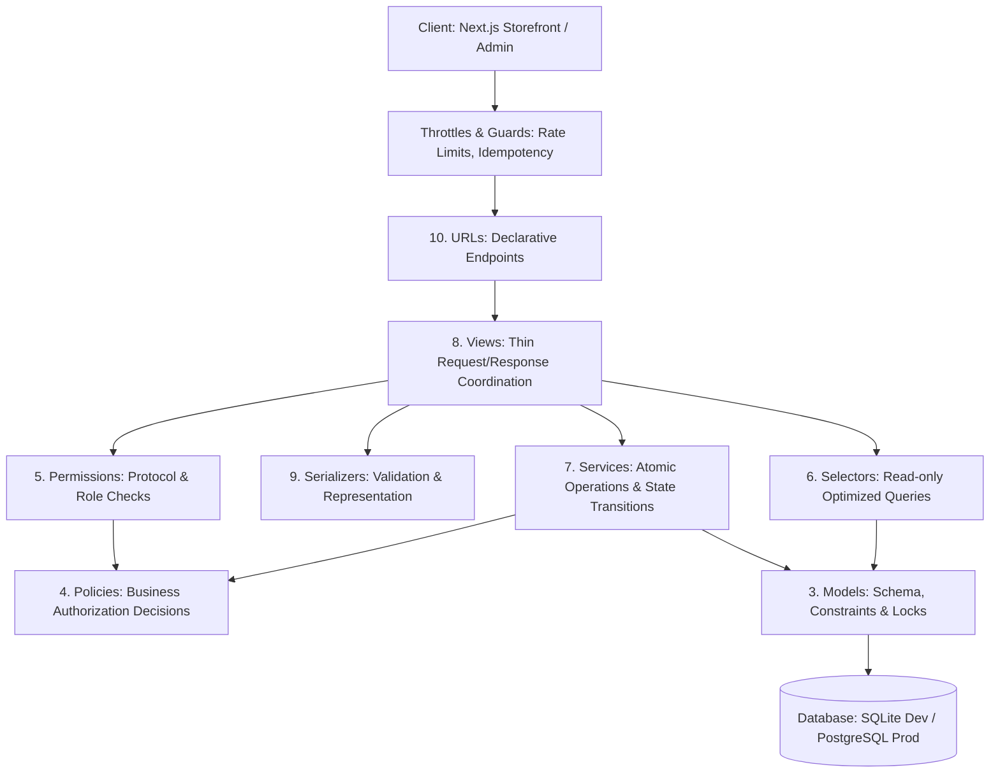
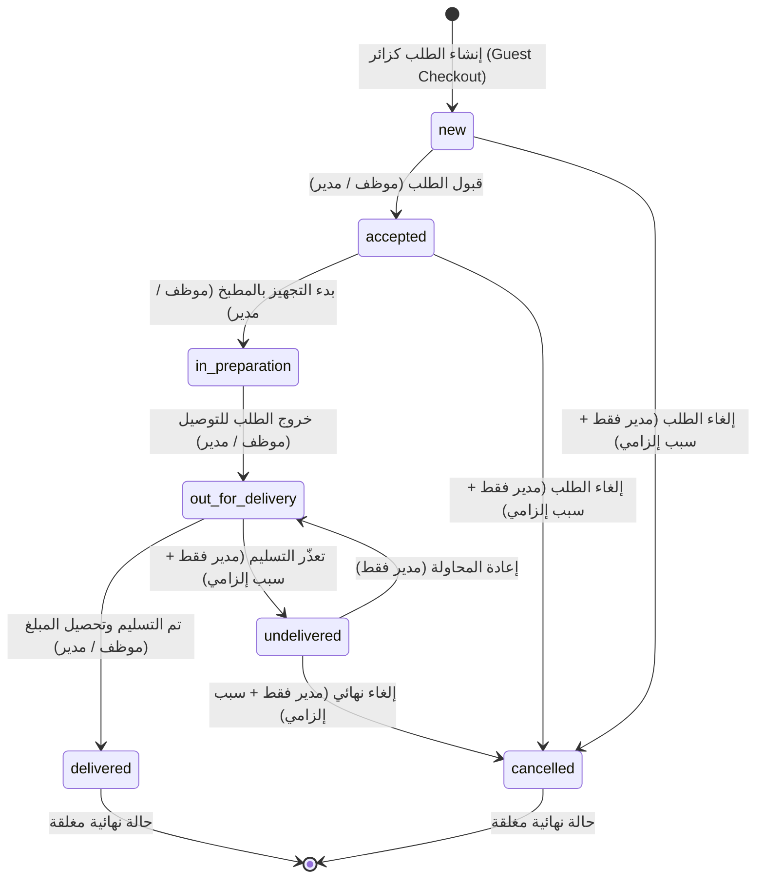

# خطة تنفيذ الواجهة الخلفية لمتجر كاندي لوز (Django REST Framework Architecture)

## 1. نظرة عامة والهدف الهندسي (Overview & Goals)
بناء النظام الخلفي المتكامل لمتجر كاندي لوز (Candy Loz E-Commerce) بالاعتماد على Django 5 و Django REST Framework، وفق نمط المعمارية الصارم المعتمد في `django-architecture-orchestrator`:
```
Models → Policies → Permissions → Selectors → Services → Views → Serializers → URLs
```
تلتزم الخطة التزاماً تاماً بالعقود البرمجية الموثقة في `API.md`، وقواعد الأعمال ومصفوفة الحالات في `PRD_v0.2.md`، ونموذج البيانات في `ERD.md`، وعقود الواجهة الأمامية في `src/types/index.ts`.

---

## 2. المبادئ المعمارية والقواعد الحاكمة (Strict Architecture Rules)



### القواعد المعمارية الثابتة:
1. **Views نحيفة (Thin Views):** لا تحتوي مطلقاً على استعلامات قاعدة بيانات معقدة ولا منطق أعمال؛ دورها يقتصر على استقبال الطلب، التحقق من الصلاحيات عبر الـ Permissions، واستدعاء الـ Selector أو الـ Service، وتمرير النتيجة للـ Serializer.
2. **عزل القراءة والكتابة (CQS):**
   - الاستعلامات محصورة في `selectors.py` (يُمنع أي Write داخل الـ Selectors مع تطبيق `select_related` و `prefetch_related` لمنع مشكلة N+1).
   - العمليات والكتابة محصورة في `services.py` مع استخدام `transaction.atomic()` لكافة العمليات المتعددة أو الحساسة مالياً.
3. **فصل الصلاحيات (Permissions) عن السياسات (Policies):**
   - الـ Permissions (DRF) تتحقق من هوية المستخدم ودوره (`IsManager`, `IsStaffOrManager`).
   - الـ Policies (Pure Python Functions) تفصل في إمكانية تنفيذ الإجراء منطقياً (مثل: هل يسمح للموظف بنقل الطلب من `in_preparation` إلى `cancelled`؟).
4. **حماية التزامن وحالات السباق (Concurrency & Race Conditions):**
   - استخدام `select_for_update()` داخل العمليات الذرية لتحديث حالات الطلبات لمنع تضارب تعديلات الموظفين المتزامنة (`EC-10`).
   - استخدام جدول تسلسلي منفصل (`OrderSequence`) مع قفل صريح لتوليد رقم الطلب `CL-YYYY-NNNN` بدون أي تصادم.
5. **تجميد اللقطة التاريخية (Historical Data Snapshot):**
   - بيانات أسعار الأصناف، الأوزان، والصور، وخيارات التغليف تُجمد في سجلات `order_items` لحظة إنشاء الطلب، ولا تتأثر نهائياً بأي تعديل مستقبلي للأسعار أو المنتجات (`BR-009`).
6. **مفتاح منع التكرار (Idempotency Key):**
   - دعم ترويسة `Idempotency-Key` وحفظ المفتاح في سجل الطلب مع قيد تفرّد، بحيث إذا أعاد العميل الإرسال (أو نقر مرتين `BR-004`) يُعاد الطلب الأصلي فوراً بدون إعادة الخصم أو التكرار.
7. **الاستجابة الموحدة والتسمية الهجينة (CamelCase & Unified Response):**
   - استخدام `CamelCaseJSONRenderer` و `CamelCaseJSONParser` لتحويل آلي شفاف بين كود بيثون الداخلي (`snake_case`) وعقود الواجهة الأمامية (`camelCase`).
   - تغليف كافة الردود الناجحة بالهيكل: `{ "success": true, "data": ..., "meta": ... }`.
   - توحيد ردود الأخطاء بالهيكل: `{ "success": false, "error": { "code": "...", "message": "...", "details": [...] } }`.

---

## 3. مصفوفة آلة الحالات وقواعد العمل (State Machine & Business Rules)

### مصفوفة الحالات السبع المعتمدة (`BR-004`):


* **قاعدة التجهيز الصارمة:** بمجرد دخول الطلب مرحلة `in_preparation`، يُمنع إلغاؤه اعتيادياً ولا يمكن نقله إلا إلى `out_for_delivery`. أي إلغاء استثنائي محصور بالمدير مع تدوين السبب.
* **الحالات النهائية:** `delivered` و `cancelled` حالات مغلقة نهائياً؛ لا يُقبل أي تعديل أو انتقال بعدهما.
* **اشتراط السبب:** الإلغاء (`cancelled`) أو تعذر التسليم (`undelivered`) يتطلبان سبباً نصياً لا يقل عن 5 أحرف (`FR-018` و `FR-035`).

---

## 4. مراحل التنفيذ التفصيلية (Detailed Execution Phases)

### Phase 1: التأسيس والبنية التحتية المشتركة (`backend/apps/common/`)
1. **البيئة والمكتبات (`requirements.txt`):**
   - `Django>=5.0,<5.2`
   - `djangorestframework>=3.15`
   - `django-cors-headers>=4.3`
   - `djangorestframework-simplejwt>=5.3`
   - `djangorestframework-camel-case>=1.4`
   - `python-dotenv>=1.0`
2. **إعدادات Django (`config/settings.py`):**
   - التطبيقات: `rest_framework`, `corsheaders`, `apps.common`, `apps.accounts`, `apps.catalog`, `apps.delivery`, `apps.orders`.
   - المنطقة الزمنية: `TIME_ZONE = 'Asia/Gaza'` مع `USE_TZ = True`.
   - إعداد CORS للسماح بالواجهة الأمامية `http://localhost:3000`.
   - إعداد التوثيق JWT لمسارات الإدارة (صلاحية الوصول 60 دقيقة، التحديث 7 أيام مع تدوير الرموز والقائمة السوداء).
   - إعداد معالج الاستثناءات الموحد `custom_exception_handler`.
   - إعداد التخزين المؤقت: `LocMemCache` افتراضياً مع إمكانية التبديل إلى Redis عبر المتغيرات البيئية لدعم Throttling.
3. **النماذج والأدوات المشتركة:**
   - `models.py`: الصنف الأساسي `TimeStampedModel` ومولد المعرفات البادئة `generate_prefixed_id` (بطول 32 محرفاً URL-safe مفهرس).
   - `renderers.py`: محوّل `UnifiedCamelCaseJSONRenderer` الذي يرث من `CamelCaseJSONRenderer` ويدمج التغليف التلقائي `{ success: true, data, meta }`.
   - `parsers.py`: تفعيل `CamelCaseJSONParser` لتحويل البيانات القادمة إلى `snake_case`.
   - `exceptions.py` & `exception_handler.py`: استثناءات الأعمال المخصصة وتحويل كافة الأخطاء إلى هيكل `{ success: false, error: { code, message, details } }`.
   - `pagination.py`: ترقيم قياسي يعتمد معاملي `page` و `limit` (الافتراضي 20، الأقصى 100) ويعيد `meta: { page, limit, totalItems, totalPages }`.
   - `validators.py`: تطبيع الهواتف الفلسطينية محلياً (`059xxxxxxx` / `056xxxxxxx`) وتجريد أي بادئات دولية قبل الحفظ.

---

### Phase 2: تطبيق الحسابات والمصادقة الإدارية (`backend/apps/accounts/`)
1. **النماذج (`models.py`):**
   - `AdminUser`: يرث من `AbstractBaseUser` و `PermissionsMixin`.
   - الحقول: `id` (`usr_*`), `username`, `full_name`, `email`, `role` (`manager`, `staff`), `is_active`, `created_at`, `updated_at`.
2. **السياسات (`policies.py`):**
   - `can_manage_admin_users(actor)`: محصورة بالمدير فقط.
   - `can_modify_user_role(actor, target)`: منع سحب الصلاحيات من آخر مدير نشط.
3. **الصلاحيات (`permissions.py`):**
   - `IsManager`: التحقق من دور `manager`.
   - `IsStaffOrManager`: متاح للمدير وموظفي التشغيل (`staff`).
4. **المحددات والخدمات (`selectors.py` & `services.py`):**
   - `get_admin_user_by_id`, `list_admin_users`.
   - `create_admin_user`, `update_admin_user`, `deactivate_admin_user`.
5. **الواجهات والتسلسل والمسارات (`views.py`, `serializers.py`, `urls.py`):**
   - `POST /api/v1/admin/auth/login`: تسجيل الدخول، توليد رموز JWT، وإرجاع بيانات الموظف.
   - `GET /api/v1/admin/auth/me`: التحقق من الجلسة وبيانات المستخدم الحالي.
   - `POST /api/v1/admin/auth/logout`: إبطال الرمز.
   - `GET/POST/PATCH /api/v1/admin/users`: إدارة الموظفين للمدير حصراً.

---

### Phase 3: تطبيق الكتالوج والمنتجات والأوزان (`backend/apps/catalog/`)
1. **النماذج (`models.py`):**
   - `Category`: `id` (`cat_*`), `slug` (Unique), `name`, `description`, `image_url`, `display_order`, `is_active`.
   - `Product`: `id` (`prod_*`), `slug` (Unique), `name`, `name_en`, `description`, `category` (FK `Category`, `RESTRICT`), `price`, `sale_price`, `unit` (`kg`, `half_kg`, `piece`, `box`), `image_url`, `gallery_images` (JSONField), `is_available`, `is_featured`, `is_archived`.
   - `ProductWeightOption`: `id` (`pwo_*`), `product` (FK `Product`, `CASCADE`), `label`, `multiplier`, `price`, `display_order`.
2. **السياسات (`policies.py`):**
   - `can_manage_catalog(user)`: مخصص للمدير (`manager`).
   - `can_toggle_availability(user)`: مسموح للمدير والموظف (`staff`, `manager`) طبقاً لـ `FR-022`.
   - `can_delete_product(user, product)`: إذا كان للمنتج طلبات سابقة في `order_items`، يُمنع الحذف الفيزيائي ويتحول تلقائياً إلى أرشفة ناعمة (`is_archived = True`, `is_available = False`) طبقاً لـ `BR-009`.
3. **المحددات (`selectors.py`):**
   - `list_storefront_categories()`: التصنيفات النشطة مرتبة حسب `display_order`.
   - `list_storefront_products(category, search, featured)`: منتجات نشطة غير مؤرشفة مع `select_related('category')` و `prefetch_related('weight_options')` للقضاء على استعلامات N+1.
   - `get_product_detail(slug_or_id)`.
   - `list_admin_products(category_id, is_available, is_archived, search)`: للمشرفين.
4. **الخدمات (`services.py`):**
   - `create_product`, `update_product`.
   - `toggle_product_availability(product_id, is_available, actor)`.
   - `delete_or_archive_product(product_id, actor)`.
5. **الواجهات والتسلسل والمسارات (`views.py`, `serializers.py`, `urls.py`):**
   - `GET /api/v1/categories`: عام للتصنيفات.
   - `GET /api/v1/products`: عام للمنتجات مع التصفية والبحث والترقيم.
   - `GET /api/v1/products/<slugOrId>`: تفاصيل الصنف والأوزان.
   - `GET/POST/PUT/DELETE /api/v1/admin/categories`: إدارة التصنيفات للمدير.
   - `GET /api/v1/admin/products`: قائمة الأصناف الكاملة للإدارة.
   - `POST/PUT /api/v1/admin/products`: إضافة وتعديل صنف للمدير.
   - `PATCH /api/v1/admin/products/<id>/availability`: تبديل فوري لتوفر الصنف (للموظف والمدير).
   - `DELETE /api/v1/admin/products/<id>`: حذف أو أرشفة ناعمة للصنف للمدير.

---

### Phase 4: تطبيق مناطق ورسوم التوصيل (`backend/apps/delivery/`)
1. **النماذج (`models.py`):**
   - `DeliveryZone`: `id` (`zone_*`), `name`, `delivery_fee`, `min_order_amount`, `estimated_time_min`, `estimated_time_max`, `is_active`.
2. **السياسات والصلاحيات (`policies.py` & `permissions.py`):**
   - `can_manage_delivery_zones(user)`: محصورة بالمدير فقط.
3. **المحددات والخدمات (`selectors.py` & `services.py`):**
   - `list_active_delivery_zones()`: للمتجر وإتمام الطلب.
   - `list_all_delivery_zones()`: للوحة التحكم الإدارية.
   - `create_delivery_zone`, `update_delivery_zone`.
4. **الواجهات والتسلسل والمسارات (`views.py`, `serializers.py`, `urls.py`):**
   - `GET /api/v1/delivery-zones`: عام للزبائن (المناطق النشطة فقط).
   - `GET/POST/PUT /api/v1/admin/delivery-zones`: إدارة المناطق للمدير.

---

### Phase 5: تطبيق الطلبات وسجل التدقيق والتتبع (`backend/apps/orders/`)
1. **النماذج (`models.py`):**
   - `OrderSequence`: جدول نووي `(year, last_number)` لتوليد أرقام الطلبات بأمان تحت التزامن.
   - `Order`:
     - `id` (`ord_*`), `order_number` (`CL-YYYY-NNNN`, unique).
     - `status`: مصفوفة الحالات السبع.
     - `payment_method`: `cash_on_delivery`.
     - `zone`: علاقة FK مع `DeliveryZone` مع `RESTRICT`.
     - `customer_name`, `customer_phone` (فلسطيني مطبع ومفهرس), `street_address`, `building_or_apt`, `customer_notes`.
     - `subtotal`, `delivery_fee`, `total`.
     - `idempotency_key`: لحماية الزبون من تكرار الطلب عند النقر المزدوج (`unique=True`, `null=True`).
     - `tracking_token`: رمز عشوائي للتحقق الآمن.
     - `cancel_reason`: سبب الإلغاء أو تعذر التسليم (إلزامي في حالتهما).
   - `OrderItem`:
     - `id`, `order` (FK `CASCADE`), `product` (FK `RESTRICT`).
     - حقول التجميد التاريخي (Snapshot): `product_name`, `product_slug`, `product_image_url`, `unit_price`, `unit`, `weight_multiplier`, `weight_label`, `packaging_label`, `packaging_fee`, `quantity`, `line_total`.
   - `OrderStatusHistory`:
     - `id`, `order` (FK `CASCADE`), `from_status`, `to_status`, `note`, `performed_by_user` (FK `AdminUser`, `SET_NULL`), `created_at`.
2. **السياسات الصارمة (`policies.py`):**
   - تطبيق جدول الانتقالات المعتمد في القسم 3.
   - قصر صلاحية الإلغاء وتعذر التسليم على المدير مع شرط سبب نصي >= 5 أحرف.
3. **المحددات والحماية (`selectors.py` & `throttling.py`):**
   - `OrderTrackFailedAttemptThrottle`: حجب الاستعلام بعد 5 محاولات فاشلة خلال 15 دقيقة لكل IP بكود `429 Too Many Requests`.
   - `get_order_for_tracking(order_number, phone)`: تتبع آمن يعتمد على تطابق رقم الطلب ورقم الهاتف المطبع.
   - `list_admin_orders(status, zone_id, search, page, limit)`: مع تحسين `select_related('zone')`.
   - `get_admin_order_detail(order_id)`: مع `prefetch_related('items', 'timeline__performed_by_user')`.
4. **الخدمات الذرية (`services.py`):**
   - `generate_next_order_number()`: توليد محمي بقفل سطري داخل `OrderSequence`.
   - `create_guest_order(customer_data, items_data, idempotency_key)`:
     - فحص مفتاح التكرار `idempotency_key` وإرجاع الطلب السابق إن وُجد.
     - تشغيل داخل `transaction.atomic()`.
     - التحقق من توفر جميع الأصناف بالمطبخ (`is_available = True`).
     - التحقق من الحد الأدنى للمنطقة (`subtotal >= zone.min_order_amount`).
     - احتساب الإجمالي وتجميد اللقطة في `OrderItem`.
     - توليد `order_number` و `tracking_token`.
     - إنشاء السجل الأولي في `OrderStatusHistory`.
   - `update_order_status(order_id, target_status, actor, reason, note)`:
     - قفل سطري `Order.objects.select_for_update().get(id=order_id)` داخل `transaction.atomic()`.
     - فحص سياسة الانتقال والتحقق من الصلاحيات والسبب.
     - تحديث الحالة وتوثيق الحدث في السجل مع معرف الموظف.
5. **الواجهات والتسلسل والمسارات (`views.py`, `serializers.py`, `urls.py`):**
   - `POST /api/v1/orders`: إنشاء طلب زائر مع التحقق من الهواتف ودعم `Idempotency-Key`.
   - `POST /api/v1/orders/track`: استعلام تتبع الطلب مع المخمد الأمني.
   - `GET /api/v1/admin/orders`: استعراض وتصفية طلبات المتجر.
   - `GET /api/v1/admin/orders/<id>`: تفاصيل الطلب وسجل الخط الزمني (Timeline).
   - `PATCH /api/v1/admin/orders/<id>/status`: ترقية وتحديث الحالة مع تطبيق السياسات.

---

### Phase 6: البيانات التجريبية والأمر الإداري (`seed_candy_loz`)
أمر تشغيل إداري `python manage.py seed_candy_loz` يملأ قاعدة البيانات ببيانات واقعية:
- المشرفون: مدير (`admin` / `Admin@123456`) وموظف تشغيل (`staff1` / `Staff@123456`).
- التصنيفات: شرقيات فاخرة، كيك وتورتات، معمول وكعك، مثلجات وعصائر، تشكيلات المناسبات.
- الأصناف: 15 صنفاً واقعياً بخيارات أوزان وصور وأسعار مطابقة للكتالوج.
- مناطق التوصيل: غزة الوسطى، الرمال وتل الهوا، الشيخ عجلين، الشمال، خانيونس، دير البلح.
- عينات طلبات تجريبية بكافة الحالات السبع لاختبار لوحة التحكم فور الإقلاع.

---

### Phase 7: خطة التحقق والاختبارات الآلية (Verification Plan)

```bash
# تشغيل كامل حزمة الاختبارات الخلفية
cd backend && python3 manage.py test --verbosity=2
```

#### حزم الاختبارات الآلية المتضمنة:
- `backend/apps/common/tests/`: اختبار الغلاف الموحد، معالج الاستثناءات، وتطبيع الهواتف.
- `backend/apps/accounts/tests/`: اختبار التوثيق، صلاحيات المدير مقابل الموظف، وحماية رموز JWT.
- `backend/apps/catalog/tests/`: اختبار سلامة الكتالوج، الأوزان، تبديل التوفر، سياسة الأرشفة الناعمة (`BR-009`)، وانعدام استعلامات N+1.
- `backend/apps/delivery/tests/`: اختبار حساب الرسوم، والحد الأدنى للطلب.
- `backend/apps/orders/tests/`:
  - `test_concurrency.py`: توليد أرقام الطلبات تحت التزامن بدون تصادم.
  - `test_idempotency.py`: إرسال نفس الطلب بمفتاح تكرار واحد والتأكد من عدم تكرار الإنشاء.
  - `test_policies.py`: مصفوفة الانتقالات السبع، منع إلغاء طلبات التجهيز، واشتراط السبب للإلغاء والتعذر.
  - `test_services.py`: إنشاء الطلب الذري، تجميد الأسعار التاريخية، ورفض الأصناف غير المتاحة.
  - `test_throttling.py`: حظر محاولات التتبع الفاشلة الزائدة بكود `429`.
  - `test_api.py`: مطابقة عقود مسارات `/api/v1/orders*` و `/api/v1/admin/orders*`.

---

## 5. حدود النطاق الصارمة (Out-of-Scope Boundaries)
تأكيداً لمتطلبات `PRD_v0.2.md` و `API.md`:
1. **لا توجد واجهات مصادقة زبائن:** الطلب كزائر فقط (`Guest Checkout`).
2. **لا توجد بوابات دفع إلكتروني:** الدفع نقداً عند الاستلام فقط (`Cash on Delivery`).
3. **لا يوجد تتبع GPS حي للمناديب:** لا مسارات WebSockets أو خرائط حية في مرحلة MVP.
4. **لا توجد كوبونات أو برامج ولاء:** غير معتمدة في MVP.
5. **لا توجد طلبات كيك مخصصة:** ميزة F-9 غير معتمدة في MVP.
