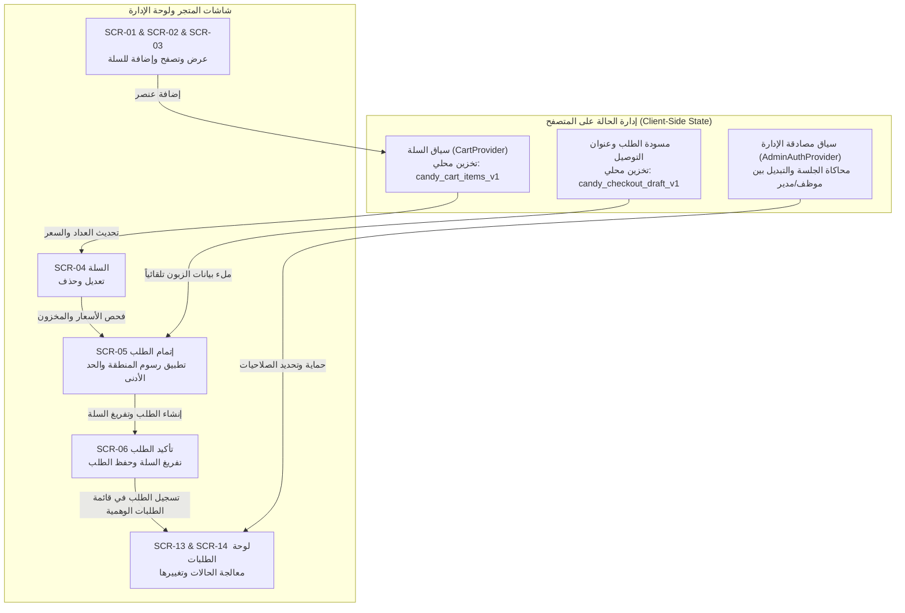

# الخطة المعمارية الشاملة للواجهة الأمامية (Frontend Plan)

**المشروع:** متجر حلويات كاندي لوز (Candy Loz E-Commerce)  
**الدور:** Senior Next.js Frontend Architect  
**التقنيات الأساسية:** Next.js (App Router), React, TypeScript, Tailwind CSS  
**المرجعيات:** `PRD_v0.2.md`, `SCREEN_INVENTORY.md`, `UX_BLUEPRINT.md`, `DESIGN.md`, `docs/STITCH_SCREEN_REFERENCES.md`

---

## 1. الفلسفة المعمارية ومبادئ التصميم

1. **التركيز الكامل على الواجهة وتجربة المستخدم (Frontend-Only Architecture):**
   - لا يتم بناء خادم خلفي فعلي أو قواعد بيانات خارجية في هذه المرحلة.
   - يتم الاعتماد على مستودعات بيانات وهمية متقدمة (`Mock Repositories`) محقونة في طبقة الخدمات، تحاكي فترات تأخير الشبكة الطبيعية (200-300ms) وتتعامل مع التخزين المحلي (`LocalStorage`) لتقديم تجربة حية وواقعية بنسبة 100%.

2. **التصميم الأصيل الموجه للغة العربية (RTL-First & Typography Excellence):**
   - الاعتماد على خط `El Messiri` للعناوين البارزة وخط `IBM Plex Sans Arabic` للنصوص وقراءة الأسعار بوضوح استناداً إلى `DESIGN.md`.
   - استخدام سمات وهوية كاندي لوز اللونية: العنابي العميق (`#800a40`)، الوردي الحيوي (`#d72d58`)، والخلفية الكريمية الحريرية (`#fff8f8`) لتعكس فخامة وجودة متجر الحلويات.

3. **أولويات الأداء والشاشات المتجاوبة (Mobile-First & High Performance):**
   - التركيز الأول على أجهزة الهواتف المحمولة وفق مخرجات أداة Stitch (أبعاد 390px مع شريط تنقل سفلي ثابت `Mobile Dock`).
   - اعتماد استراتيجية العرض التدريجي وSkeleton Loaders لمنع اهتزاز الشاشة (CLS = 0).

---

## 2. إدارة الحالة (State Management Strategy)

- **سلة التسوق (`CartContext`):**
  - إدارة عناصر السلة، حساب الإجمالي، وتطبيق فحص توفر الأصناف والأسعار الحالية (EC-01, EC-02) عند الانتقال من السلة إلى الدفع.
  - تفريغ السلة تلقائياً عند إنتاج الطلب في صفحة التأكيد SCR-06.
- **مصادقة المشرفين (`AdminAuthContext`):**
  - تبديل فوري بين دور "موظف" (Staff) ودور "مدير" (Manager) لاختبار قيود الصلاحيات وشاشة الحظر SCR-20 بكل سلاسة.

---

## 3. التعامل مع الأخطاء والحالات الخاصة (Edge Cases & Boundaries)

1. **انقطاع الاتصال أو الخطأ غير المتوقع (SCR-10):**
   - استخدام مكون `error.tsx` لتقديم واجهة ودية مريحة مع زر "إعادة المحاولة" دون إغلاق التطبيق.
2. **الصفحات غير الموجودة (SCR-09):**
   - شاشة 404 مخصصة بهوية كاندي لوز تتضمن زراً واضحاً للعودة إلى الصفحة الرئيسية.
3. **تغير الأسعار أو نفاد الكمية أثناء الشراء (EC-01, EC-02):**
   - إشعار الزبون بشريط تنبيه داخل السلة وإعادة تسعير الأصناف قبل الانتقال لصفحة إتمام الطلب.
4. **محاولات التتبع الخاطئة (SCR-07 / ER-005):**
   - عرض رسالة عامة محايدة "تعذر العثور على الطلب بالبيانات المدخلة" لمنع التخمين وحماية خصوصية الزبائن.
