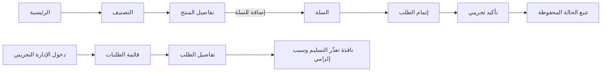

# معرض واجهات SweetMarket

صور كاملة الصفحات لواجهة المتجر ولوحة الإدارة، بالإضافة إلى لقطات هاتفية للمسارات الأساسية. صور سطح المكتب التُقطت عند 1440×1050، وصور الهاتف عند 390×844.

> **بيانات العرض:** صُوّر مسار الشراء بطلب تجريبي محلي ورقم `CL-2026-2921` واسم/عنوان/هاتف اصطناعي. لم يُرسل الطلب إلى API أو متجر أو شركة توصيل. دخول الإدارة وحالات الطلبات في هذه النسخة تجريبية محلية.

## الانتقالات التي جرى اختبارها

## واجهة المتجر

| الواجهة / الحالة | المسار | الصورة |
|---|---|---|
| الصفحة الرئيسية | `/` | [عرض الصورة](screenshots/00-home.png) |
| تصنيف البقلاوة | `/category/baklava-eastern` | [عرض الصورة](screenshots/01-category-baklava.png) |
| تفاصيل المنتج | `/product/mixed-baklava-extra-pistachio` | [عرض الصورة](screenshots/02-product-detail.png) |
| المنتج بعد الإضافة للسلة | حالة تفاعلية من صفحة المنتج | [عرض الصورة](screenshots/03-product-added.png) |
| سلة فيها منتج | `/cart` | [عرض الصورة](screenshots/04-cart.png) |
| نموذج إتمام الطلب | `/checkout` | [عرض الصورة](screenshots/05-checkout.png) |
| الدفع ببيانات عرض اصطناعية | `/checkout`، المنطقة والرسوم ظاهرتان | [عرض الصورة](screenshots/05b-checkout-filled.png) |
| تأكيد الطلب التجريبي | `/checkout/success/CL-2026-2921` | [عرض الصورة](screenshots/06-order-success.png) |
| نموذج التتبع | `/track` | [عرض الصورة](screenshots/07-track-form.png) |
| نتيجة تتبع الطلب المحلي | `/track` | [عرض الصورة](screenshots/08-track-result.png) |
| حساب الزائر | `/account` | [عرض الصورة](screenshots/09-account.png) |
| المفضلة الفارغة | `/favorites` | [عرض الصورة](screenshots/10-favorites-empty.png) |
| التواصل وساعات العمل | `/contact` | [عرض الصورة](screenshots/11-contact.png) |
| صفحة 404 | مسار غير موجود | [عرض الصورة](screenshots/24-not-found.png) |

## لوحة الإدارة

| الواجهة / الحالة | المسار | الصورة |
|---|---|---|
| تسجيل دخول المدير التجريبي | `/admin/login` | [عرض الصورة](screenshots/12-admin-login.png) |
| قائمة الطلبات | `/admin/orders` | [عرض الصورة](screenshots/13-admin-orders.png) |
| تفاصيل طلب | `/admin/orders/ord-1004` | [عرض الصورة](screenshots/14-admin-order-detail.png) |
| حوار تعذّر التسليم مع سبب مطلوب | `/admin/orders/ord-1004` | [عرض الصورة](screenshots/15-admin-undelivered-dialog.png) |
| المنتجات | `/admin/products` | [عرض الصورة](screenshots/16-admin-products.png) |
| إضافة منتج | `/admin/products/new` | [عرض الصورة](screenshots/17-admin-product-create.png) |
| تعديل منتج | `/admin/products/prod-baklava-mixed/edit` | [عرض الصورة](screenshots/18-admin-product-edit.png) |
| التصنيفات | `/admin/categories` | [عرض الصورة](screenshots/19-admin-categories.png) |
| مناطق التوصيل | `/admin/zones` | [عرض الصورة](screenshots/20-admin-zones.png) |
| مستخدمو لوحة الإدارة | `/admin/users` | [عرض الصورة](screenshots/21-admin-users.png) |
| إعداد كلمة المرور | `/admin/account/password` | [عرض الصورة](screenshots/22-admin-password.png) |
| رفض الوصول | `/admin/forbidden` | [عرض الصورة](screenshots/23-admin-forbidden.png) |

## عرض الهاتف

| الواجهة | الصورة |
|---|---|
| الرئيسية — 390×844 | [عرض الصورة](screenshots/25-mobile-home.png) |
| تفاصيل المنتج — 390×844 | [عرض الصورة](screenshots/26-mobile-product.png) |
| السلة — 390×844 | [عرض الصورة](screenshots/27-mobile-cart.png) |
| إتمام الطلب — 390×844 | [عرض الصورة](screenshots/28-mobile-checkout.png) |

للتفاصيل عن فجوة التكامل بين الواجهات وعقد الخدمة، راجع [تقرير مراجعة API](API_AUDIT.md) و[خريطة المسارات](ROUTES_MAP.md). بيانات أسماء الملفات والمسارات متاحة أيضاً في [manifest.json](screenshots/manifest.json).
