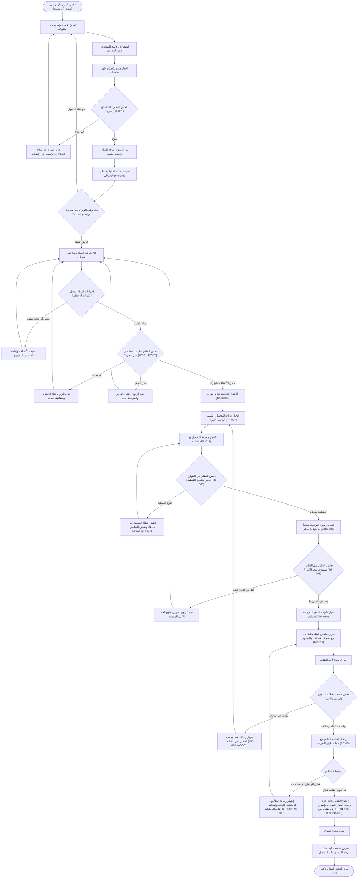
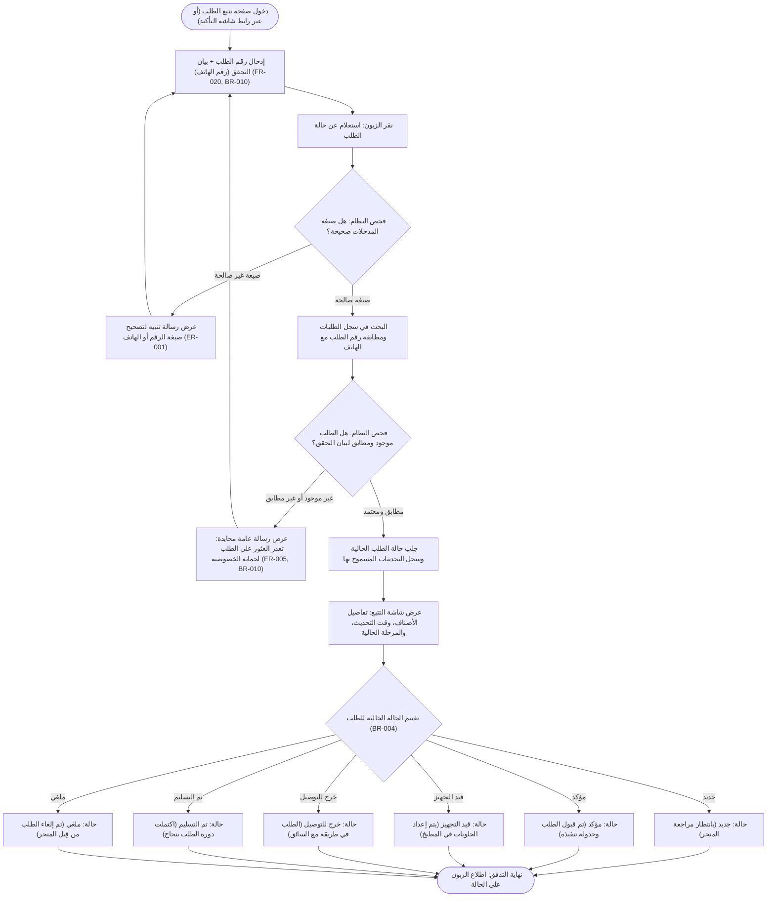
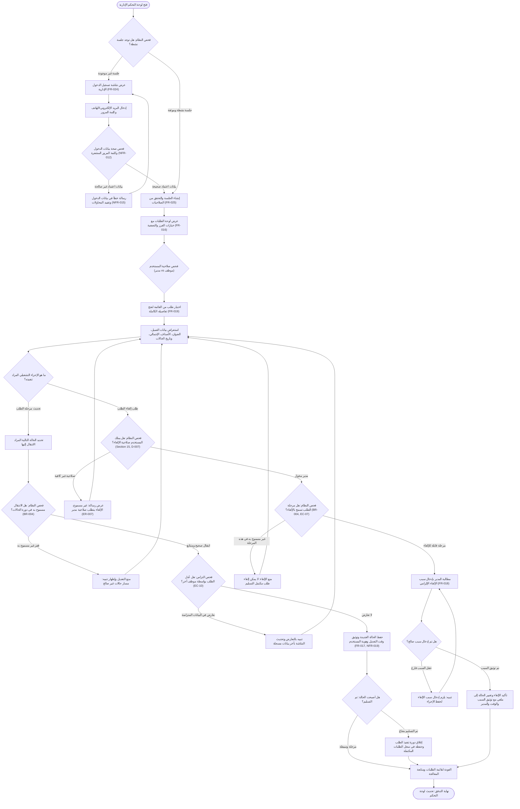
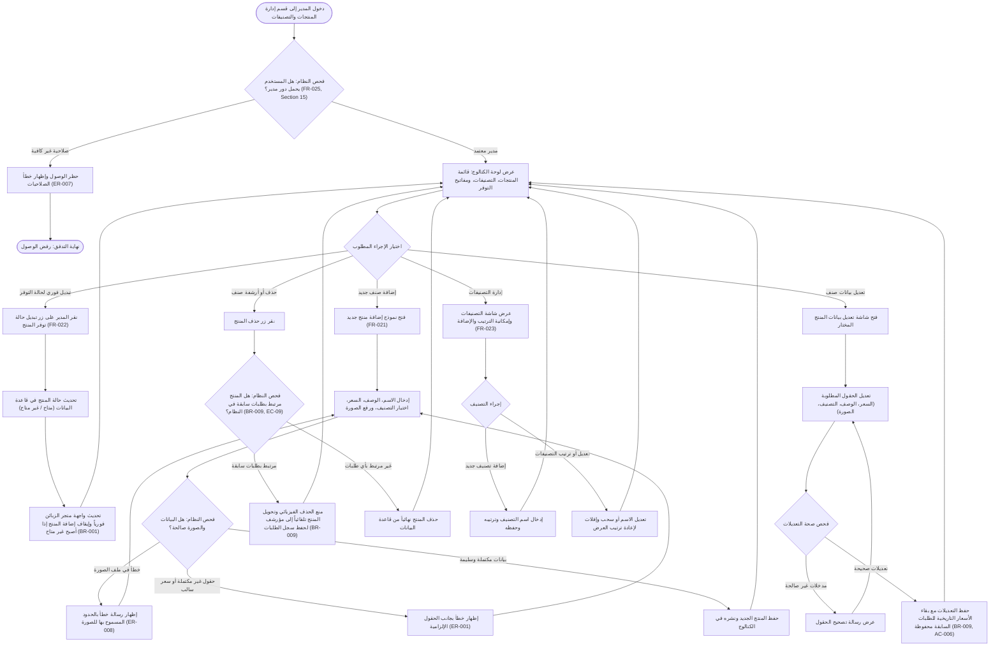
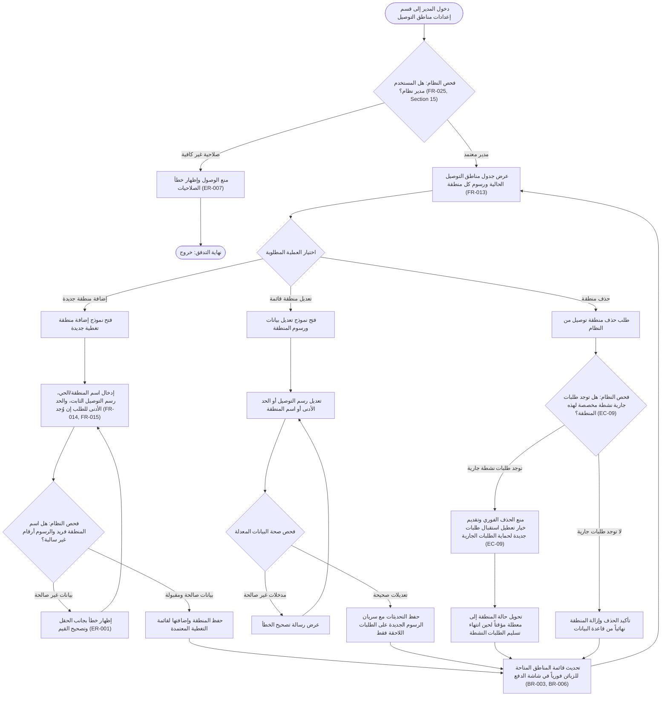

# وثيقة تدفقات المستخدم (User Flows) - متجر حلويات مع توصيل (تطبيق ويب)

**الإصدار:** 1.0  
**التاريخ:** 27 أكتوبر 2026  
**الدور المصمم:** Senior UX Designer  
**المرجعية:** مستند متطلبات المنتج [PRD.md](file:///home/mahmoud/Desktop/متجر%20حلويات/PRD.md) (الإصدار 0.1.1)

---

## 1. المقدمة ودليل المطابقة مع الـ PRD

تحدد هذه الوثيقة تدفقات تجربة المستخدم (User Flows) للرحلات الأساسية المؤكدة والمقترحة ضمن نطاق الحد الأدنى للمنتج (MVP) لمتجر الحلويات الإلكتروني. روعي في تصميم كل تدفق:
- الفصل الصارم بين إجراءات المستخدم (`User Actions`) واستجابات النظام الآنية (`System Responses`).
- إبراز نقاط اتخاذ القرار (`Decision Points`) ومسارات النجاح (`Success Paths`) ومسارات الخطأ وحالات الحواف (`Error & Edge Paths`).
- حالات الدخول والخروج (`Entry/Exit States`) والتنقل المبني على الأدوار (`Role-Based Navigation`).
- الالتزام التام بالقواعد التشغيلية المذكورة في PRD دون اختراع أي منطق تجاري غير موثق.

### دليل الحالات ومصدر القواعد:
* ✅ **مؤكد:** متطلب منصوص عليه صراحة من المقابلة (مثل المنصة ويب باللغة العربية، متجر حلويات مع توصيل).
* 🟡 **افتراض:** افتراض في PRD لم يُحسم من صاحب المنتج (مثل إتاحة الطلب كزائر دون تسجيل حساب).
* 🔵 **قرار مقترح:** توصية تصميمية أو تشغيلية محددة بالـ PRD بانتظار الاعتماد الرسمي.
* ❓ **سؤال مفتوح:** نقطة مجهولة في PRD تحجب استقرار المسار التشغيلي.

### مصفوفة الأدوار وصلاحيات التنقل (Role-Based Navigation Matrix):
| الدور | شاشات الدخول المسموحة | الصلاحيات التشغيلية في التدفقات | المرجع في PRD |
|---|---|---|---|
| **زائر / زبون (Guest / Customer)** | الرئيسية، الكتالوج، تفاصيل المنتج، السلة، إتمام الطلب، تأكيد الطلب، تتبع الطلب | تصفح المنتجات، إدارة السلة، إنشاء طلب بتوصيل، استعلام عن حالة طلبه فقط | Section 15, FR-026, D-003 🟡 |
| **موظف المتجر (Staff)** | بوابة الإدارة، لوحة معالجة الطلبات، تفاصيل الطلب | استعراض كل الطلبات، ترقية حالات التجهيز والتوصيل | Section 15, FR-016, FR-017, D-007 🔵 |
| **مدير المتجر (Store Manager)** | كامل لوحة الإدارة (الطلبات، الكتالوج، مناطق التوصيل، الإعدادات) | كافة الصلاحيات: معالجة وإلغاء الطلبات، إدارة المنتجات والتصنيفات، وتحديد مناطق ورسوم التوصيل | Section 15, FR-021..FR-025 🔵 |

---

## 2. الرحلة الأولى: رحلة الزبون - تصفح الحلويات، إدارة السلة، وإتمام الطلب بتوصيل
*(Customer Browsing, Cart & Checkout Journey)*

### أ. نظرة عامة وحالات الدخول والخروج:
* **الدور المستهدف:** زائر / زبون (Guest / Customer).
* **حالة الدخول (Entry State):** فتح الموقع عبر المتصفح (Web/Mobile Browser) والوصول إلى الصفحة الرئيسية (NFR-001, C-02).
* **حالة الخروج (Exit State):**
  * *مسار النجاح:* إنشاء الطلب بحالة "جديد"، تثبيت الأسعار وقت الشراء، إصدار رقم مرجعي فريد، وتفريغ السلة مع الانتقال لشاشة التأكيد (FR-012, BR-004, BR-009, BR-010).
  * *مسار الإلغاء/التعذر:* بقاء محتويات السلة محفوظة في جلسة التصفح المحلية، أو تنبيه الزبون بعدم توفر التغطية (FR-006, ER-004).

### ب. مخطط التدفق البرمجي (Mermaid Flowchart TD):

### ج. الشرح التفصيلي للخطوات (Arabic Explanation):
1. **إجراءات المستخدم (User Actions):**
   - يدخل الزبون إلى المتجر، ويتصفح التصنيفات (معجنات، كيك، حلويات شرقية).
   - يختار صنفاً للاطلاع على سعره وصورته ووصفه ومستوى توفره.
   - يحدد الكمية ويضيف الصنف إلى سلة التسوق.
   - يفتح السلة لمراجعة اختياراته، أو تعديل الكميات، أو حذف ما لا يرغب به.
   - يضغط على "متابعة الطلب" وينتقل لصفحة إتمام الطلب (Checkout).
   - يدخل بيانات التوصيل الأساسية: الاسم الكامل، رقم الهاتف الجوال، العنوان النصي التفصيلي، ويختار المنطقة الجغرافية التابع لها.
   - يحدد طريقة الدفع (الدفع عند الاستلام المعتمدة لمرحلة MVP).
   - يراجع الملخص النهائي (قيمة الأصناف + رسوم التوصيل المحددة للمنطقة = الإجمالي النهائي).
   - ينقر على زر "تأكيد الطلب".

2. **استجابات النظام (System Responses):**
   - تقديم واجهة عربية متجاوبة تماماً مع شاشات الجوال (RTL / Mobile-First).
   - التحقق اللحظي من حالة توفر المنتج؛ وإذا كان "غير متاح" يتم تعطيل زر الإضافة وتوضيح الحالة منعاً للإحباط (Affordance & Feedback).
   - حفظ حالة السلة في الذاكرة المحلية للجلسة، وحساب الإجمالي تلقائياً مع كل تعديل.
   - التحقق من سلامة الأصناف بالسلة قبل فتح صفحة الدفع (التأكد من عدم نفاد الكميات أو تعديل الأسعار أثناء تصفح الزبون).
   - فحص تغطية المنطقة: إذا اختار الزبون منطقة غير مدرجة يتم توضيح أن المتجر لا يغطي هذه المنطقة حالياً.
   - حساب رسوم التوصيل بدقة وفق المنطقة المختارة ودمجها بالفاتورة.
   - التحقق من صحة رقم الهاتف والمدخلات في الواجهة والخادم دون تفريغ النموذج في حال الخطأ.
   - تفعيل آلية حماية من تكرار الإرسال (Idempotency) لمنع تكرار الطلب عند النقر المزدوج السريع.
   - عند نجاح العملية: حفظ الطلب بحالة "جديد"، وتثبيت سعر الشراء، وإصدار رقم طلب مرجعي فريد وتفريغ السلة وتوجيه العميل لصفحة التأكيد.

3. **نقاط القرار (Decision Points):**
   - هل المنتج متاح للطلب أم نفد من المتجر؟
   - هل يرغب الزبون في استكمال التصفح أم التوجه للدفع؟
   - هل طرأ تغيير على أسعار أو توفر محتويات السلة قبل الدفع؟
   - هل يقع عنوان الزبون ضمن النطاق الجغرافي المغطى؟
   - هل يستوفي الطلب الحد الأدنى للمنطقة (إن تم تفعيله)؟
   - هل المدخلات الشخصية ورقم الهاتف مكتملة وصحيحة؟
   - هل نجحت عملية الاتصال بالخادم وحفظ السجل؟

4. **مسارات الخطأ والتعامل مع الحالات الحدية (Error & Edge Paths):**
   - `ER-003 / BR-001`: ظهور منتج غير متاح ← يُعطل زر الإضافة ويُعرض وسم صريح.
   - `EC-01`: نفاد منتج وهو داخل السلة ← تنبيه توضيحي ومطالبة الزبون بإزالته لاستكمال الشراء.
   - `EC-02`: تغير سعر المنتج أثناء وجوده بالسلة ← إظهار تنبيه يوضح الفرق ويطلب موافقة العميل.
   - `ER-004 / BR-006 / EC-04`: منطقة خارج التغطية ← رفض استكمال الطلب مع بيان قائمة المناطق المشمولة.
   - `ER-001 / AC-001`: رقم هاتف بتنسيق غير سليم ← ظهور رسالة خطأ مباشرة بمحاذاة الحقل دون مسح بقية البيانات.
   - `EC-03`: ضغط مزدوج على زر التأكيد ← معالجة الطلب مرة واحدة ومنع التكرار.
   - `ER-002 / AC-007`: انقطاع الاتصال بالإنترنت أو فشل الخادم ← إظهار رسالة خطأ ودية مع بقاء بيانات السلة كما هي وإتاحة زر إعادة المحاولة.

### د. المتطلبات المرتبطة من PRD:
- **الميزات والمطابقة:** `F-1` (عرض المنتجات), `F-2` (السلة), `F-3` (إتمام الطلب), `F-4` (مناطق التوصيل والرسوم).
- **المتطلبات الوظيفية:** `FR-001`, `FR-002`, `FR-004`, `FR-005`, `FR-006`, `FR-007`, `FR-008`, `FR-010`, `FR-011`, `FR-012`, `FR-014`, `FR-015`, `FR-026`, `FR-030`.
- **قواعد العمل (Business Rules):** `BR-001`, `BR-002`, `BR-003`, `BR-004`, `BR-006`, `BR-008`, `BR-009`, `BR-010`.
- **معايير القبول والحالات الحدية:** `AC-001`, `AC-004`, `AC-005`, `AC-007`, `EC-01`, `EC-02`, `EC-03`, `EC-04`, `ER-001`, `ER-002`, `ER-003`, `ER-004`.

### هـ. الأسئلة المفتوحة والافتراضات غير المحسومة المؤثرة على الرحلة:
* **Q-05 / D-001 ❓:** هل يدعم المتجر الاستلام من الفرع (`FR-008`) إلى جانب التوصيل؟ التدفق يركز حالياً على التوصيل المؤكد.
* **Q-06 / D-002 ❓:** طريقة الدفع؛ تم اعتماد "الدفع عند الاستلام" كافتراض تشغيلي لتفادي تعقيدات بوابات الدفع في الـ MVP.
* **Q-07 / D-005 ❓:** ساعات العمل ومواعيد إغلاق استقبال الطلبات اليومية وهل يُسمح بجدولة التوصيل لوقت لاحق (`FR-009`)؟
* **Q-08 / D-004 ❓:** هل يوجد حد أدنى للطلب لكل منطقة أو حد عام؟ تم تضمينه كفحص شرطي في النظام بناءً على مسودة PRD.
* **Q-09 / D-003 🟡:** اعتماد تدفق "الطلب كزائر" (Guest Checkout) لتقليل خطوات الشراء لعدم وجود متطلب حسابات في الـ MVP.
* **Q-11 ❓:** هل الأسعار المعروضة شاملة لضريبة القيمة المضافة وما هي العملة الرسمية للمتجر؟

---

## 3. الرحلة الثانية: رحلة الزبون - الاستعلام وتتبع حالة الطلب
*(Customer Order Tracking Journey)*

### أ. نظرة عامة وحالات الدخول والخروج:
* **الدور المستهدف:** زائر / زبون أتم طلباً (Customer / Guest with existing order).
* **حالة الدخول (Entry State):** الوصول عبر الرابط المباشر من شاشة تأكيد الطلب، أو النقر على "تتبع طلبي" من شريط التنقل العلوي للمتجر.
* **حالة الخروج (Exit State):**
  * *مسار النجاح:* عرض الحالة التشغيلية للطلب (جديد، مؤكد، قيد التجهيز، خرج للتوصيل، تم التسليم، أو ملغي) مع بيانات الملخص وتاريخ التحديث (FR-020, BR-004).
  * *مسار الخطأ:* إظهار رسالة عامة تفيد بعدم العثور على الطلب لحماية سرية البيانات الشخصية (ER-005, BR-010).

### ب. مخطط التدفق البرمجي (Mermaid Flowchart TD):

### ج. الشرح التفصيلي للخطوات (Arabic Explanation):
1. **إجراءات المستخدم (User Actions):**
   - يدخل الزبون لصفحة التتبع (أو يُحوّل إليها تلقائياً مع تعبئة المعرف في حال الدخول من رسالة أو شاشة التأكيد).
   - يُدخل رقم الطلب المرجعي ويُدخل رقم هاتفه الشخصي المعتمد في الطلب للتأكيد (Two-factor lookup).
   - يضغط على زر "استعلام".

2. **استجابات النظام (System Responses):**
   - التحقق الأولي من اكتمال وصحة صياغة الحقول.
   - التحقق الأمني: مطابقة رقم الطلب ورقم الهاتف مع قاعدة البيانات؛ لمنع أي محاولة تخمين لأرقام الطلبات للوصول لعناوين وأسماء زبائن آخرين (ID Enumeration Prevention / Privacy BR-010).
   - في حال التطابق: إرجاع الحالة التشغيلية الحالية للطلب فقط مع جدول زمني بسيط للمراحل التي مر بها، دون كشف أية بيانات حساسة.
   - في حال عدم التطابق: عرض رسالة محايدة تماماً ("لم يتم العثور على طلب مطابق للمدخلات").

3. **نقاط القرار (Decision Points):**
   - هل رقم الطلب ورقم الهاتف مطابقان لسجل مسجل بالنظام؟
   - ما هي المرحلة التشغيلية الحالية للطلب ضمن دورة الحالات الرسمية (`BR-004`)؟

4. **مسارات الخطأ والتعامل مع الحالات الحدية (Error & Edge Paths):**
   - `ER-001`: ترك أحد الحقول فارغاً ← تنبيه المستخدم قبل إرسال الطلب للخادم.
   - `ER-005 / BR-010`: إدخال رقم طلب غير موجود أو برقم هاتف مغاير ← إظهار رسالة خطأ عامة لحماية خصوصية بيانات العملاء.

### د. المتطلبات المرتبطة من PRD:
- **الميزات:** `F-7` (تتبع حالة الطلب للزبون).
- **المتطلبات الوظيفية:** `FR-020`, `FR-030`.
- **قواعد العمل:** `BR-004` (دورة حالات الطلب), `BR-010` (أمان رقم الطلب والتحقق الإضافي).
- **حالات الخطأ والأمان:** `ER-001`, `ER-005`, `NFR-014`, `NFR-016`.

### هـ. الأسئلة المفتوحة والافتراضات غير المحسومة المؤثرة على الرحلة:
* **Q-09 / D-003 🟡:** التحقق برقم الهاتف + رقم الطلب هو الآلية المقترحة لتعويض غياب حسابات الزبائن المسجلة.
* **Q-10 ❓:** هل يُعرض سبب الإلغاء للزبون في حال كان الطلب "ملغي" أم تظهر الحالة مجردة مع رقم للتواصل؟
* **FR-028 ❓ (Nice):** هل سيتم تزويد الزبون برابط تتبع عبر رسائل SMS أو واتساب آلياً عند تغير الحالة؟

---

## 4. الرحلة الثالثة: رحلة فريق العمل / الإدارة - دورة معالجة الطلبات وإلغائها
*(Order Lifecycle Management & Cancellation Journey)*

### أ. نظرة عامة وحالات الدخول والخروج:
* **الدور المستهدف:** موظف المتجر (Staff) / مدير المتجر (Store Manager).
* **حالة الدخول (Entry State):** التوجه إلى مسار لوحة التحكم الإدارية عبر المتصفح (`/admin`).
* **حالة الخروج (Exit State):**
  * *مسار النجاح:* نقل الطلب إلى المرحلة التالية في دورة الحياة وحفظ الوقت وهوية المستخدم في سجل التدقيق (FR-017, NFR-019).
  * *مسار الإلغاء:* إلغاء الطلب من قِبل المدير مع تدوين السبب الإلزامي في النظام (FR-018, BR-005).
  * *مسار الخطأ الأمني:* رفض الوصول لانتهاء الجلسة أو عدم كفاية الصلاحيات (ER-006, ER-007).

### ب. مخطط التدفق البرمجي (Mermaid Flowchart TD):

### ج. الشرح التفصيلي للخطوات (Arabic Explanation):
1. **إجراءات المستخدم (User Actions):**
   - يدخل الموظف أو المدير بيانات الاعتماد في شاشة تسجيل الدخول.
   - يتصفح لوحة التحكم ويستخدم فلاتر الحالات (عرض الطلبات "الجديدة" أولاً لتأكيدها).
   - يضغط على رقم الطلب لعرض بطاقة التفاصيل الكاملة (الأصناف، الملاحظات، العنوان، الهاتف، القيمة).
   - يختار تحديث الحالة عبر قائمة منسدلة أو زر الإجراء السريع (مثلاً: نقل من "جديد" إلى "مؤكد"، ثم إلى "قيد التجهيز").
   - في حال الرغبة في الإلغاء (للمدير فقط): يضغط على زر "إلغاء الطلب"، ويدخل السبب التوضيحي (مثلاً: تعذر التواصل مع العميل، نفاد المكونات)، ثم يؤكد الإلغاء.

2. **استجابات النظام (System Responses):**
   - التحقق الصارم من كلمات المرور المشفرة والصلاحيات الأمنية لكل عملية إدارية بالخادم (NFR-012, NFR-013).
   - فرض قيود على مسار الحالات (State Machine Enforcement): لا يسمح النظام بالقفز العشوائي للحالات (مثلاً: لا يمكن تحويل طلب من "جديد" إلى "تم التسليم" مباشرةً).
   - التحقق من تضارب العمليات المتزامنة (Concurrency Check - EC-10): إذا قام موظفان بفتح نفس الطلب وعدّل أحدهما حالته، يتم تنبيه الموظف الآخر بآخر حالة تم حفظها ومنع الكتابة فوقها.
   - توثيق كل تغيير في سجل الحالات (`Audit Log`): حفظ اسم المستخدم الذي أجرى التعديل، والوقت الدقيق بالثواني، والحالة السابقة والجديدة (FR-017, NFR-019).
   - عند الإلغاء: فحص الحقل الإلزامي لسبب الإلغاء، وتسجيله بالسجل التشغيلي.

3. **نقاط القرار (Decision Points):**
   - هل بيانات الدخول صحيحة ومحمية من هجمات التخمين؟
   - هل يمتلك المستخدم الصلاحية المناسبة للإجراء (تجهيز vs إلغاء)؟
   - هل الانتقال المطلوب للحالة التالية انتقال منطقي مسموح به حسب `BR-004`؟
   - هل تضارب التعديل مع تعديل متزامن من موظف آخر؟
   - هل سبب الإلغاء مدون ومكتمل؟

4. **مسارات الخطأ والتعامل مع الحالات الحدية (Error & Edge Paths):**
   - `ER-006`: انتهاء جلسة تسجيل الدخول الإدارية ← إعادة توجيه شاشة الدخول مع الحفاظ على مسار الصفحة الحالية بعد تسجيل الدخول.
   - `ER-007 / AC-003`: محاولة موظف إلغاء طلب دون امتلاك الصلاحية ← إظهار رسالة رفض وإيقاف العملية وتوثيق المحاولة.
   - `EC-10`: تعديل متزامن من شخصين على نفس الطلب ← عرض تنبيه تعارض وإعادة تحميل بيانات الطلب بأحدث نسخة مسجلة.
   - `BR-004 / F-5 AC`: محاولة اختيار حالة غير متتالية في دورة الحياة ← إظهار خطأ يوضح المسار المعتمد للحالات.
   - `FR-018`: محاولة تأكيد الإلغاء دون كتابة السبب ← تعطيل الحفظ وإبراز حقل السبب كمتطلب إجباري.

### د. المتطلبات المرتبطة من PRD:
- **الميزات:** `F-5` (إدارة الطلبات).
- **المتطلبات الوظيفية:** `FR-016`, `FR-017`, `FR-018`, `FR-019`, `FR-024`, `FR-025`, `FR-027`.
- **قواعد العمل:** `BR-004` (دورة حالات الطلب: جديد ← مؤكد ← قيد التجهيز ← خرج للتوصيل ← تم التسليم)، `BR-005` (سياسة الإلغاء).
- **حالات الحواف ومعايير القبول:** `AC-002`, `AC-003`, `AC-008`, `EC-07`, `EC-10`, `ER-006`, `ER-007`.
- **المتطلبات غير الوظيفية والأمان:** `NFR-012`, `NFR-013`, `NFR-015`, `NFR-019`.

### هـ. الأسئلة المفتوحة والافتراضات غير المحسومة المؤثرة على الرحلة:
* **Q-04 / D-007 🔴:** هيكلية الأدوار النهائية؛ هل سيتعامل سائق التوصيل مع النظام بنفسه لتغيير حالة "تم التسليم" أم تسند للمدير والموظف فقط؟ (الافتراض المقترح: مدير وموظف فقط بالـ MVP).
* **Q-05 🔴:** آلية إسناد الطلب للسائق وتزويده بالعناوين في ظل خروج تطبيق السائق المخصص من نطاق الـ MVP.
* **Q-10 ❓:** سياسة إلغاء الطلبات بعد بدء التجهيز الفعلي في المطبخ، والمسؤولية المالية للمنتجات التالفة.
* **FR-027 ❓:** قناة الإشعارات المعتمدة لتنبيه الإدارة بالطلبات الواردة فور وصولها (صوت تنبيه في المتصفح، رسالة بريد، واتساب).

---

## 5. الرحلة الرابعة: رحلة مدير المتجر - إدارة قائمة الحلويات والتصنيفات والتوفر
*(Store Catalog, Products & Categories Management Journey)*

### أ. نظرة عامة وحالات الدخول والخروج:
* **الدور المستهدف:** مدير المتجر حصراً (Store Manager / Admin).
* **حالة الدخول (Entry State):** المدير مسجل دخوله وينتقل لقسم "إدارة المنتجات والتصنيفات" في القائمة الجانبية للوحة التحكم.
* **حالة الخروج (Exit State):**
  * *مسار النجاح:* حفظ التعديلات أو المنتجات الجديدة في قاعدة البيانات وانعكاسها فورياً في واجهة تصفح الزبائن (FR-021, F-6 AC).
  * *مسار الأرشفة الحتمية:* تحويل الصنف للأرشفة بدلاً من حذفه نهائياً لحماية سجل الطلبات التاريخية (BR-009, AC-006).

### ب. مخطط التدفق البرمجي (Mermaid Flowchart TD):

### ج. الشرح التفصيلي للخطوات (Arabic Explanation):
1. **إجراءات المستخدم (User Actions):**
   - يفتح المدير صفحة الكتالوج الإدارية.
   - **التبديل السريع للتوفر:** ينقر على مفتاح التبديل (Toggle Switch) بجانب أي منتج لتحويله إلى "غير متاح" فور نفاد صينية حلويات معينة في المتجر لتفادي استمرار طلبها.
   - **إضافة منتج:** يضغط على "إضافة منتج"، يدخل الاسم التجاري، الوصف التفصيلي، السعر بالعملة المحلية، يحدد القسم/التصنيف، ويرفع صورة واضحة.
   - **تعديل منتج:** يفتح بطاقة المنتج ويعدل السعر أو الصورة أو المكونات.
   - **حذف منتج:** يضغط على أيقونة الحذف لصنف يرغب في إزالته من القائمة.
   - **إدارة التصنيفات:** ينشئ تصنيفاً جديداً (مثل: "حلويات رمضانية") أو يغير ترتيب ظهور التصنيفات في الواجهة الرئيسية.

2. **استجابات النظام (System Responses):**
   - التحقق من صلاحية المدير الحصرية ومنع موظفي التجهيز العاديين من المساس بالأسعار والكتالوج (Section 15, ER-007).
   - عند تغيير حالة التوفر: ينعكس التغيير فورياً على متجر الزبائن ويتعطل زر الإضافة تلقائياً (BR-001).
   - التحقق من شروط الإدخال: منع تسجيل أسعار صفرية أو سالبة، والتحقق من امتداد وحجم ملف الصورة المرفوعة (ER-008).
   - **تطبيق قاعدة حماية سجل الطلبات التاريخية (`BR-009`):** إذا طلب المدير حذف منتج سبق شراؤه في طلبات سابقة، يمنع النظام الحذف الفيزيائي من قاعدة البيانات تماماً؛ بل يقوم بأرشفة المنتج تلقائياً (Soft Delete / Archive)، وإخفائه من واجهة الزبائن مع بقاء كافة بياناته وسعره القديم محفوظة في شاشات فواتير الزبائن السابقة (AC-006).

3. **نقاط القرار (Decision Points):**
   - هل المستخدم يحمل دور مدير مخول بتعديل الكتالوج والأسعار؟
   - ما نوع الإجراء المطلوب (توفر فوري، إنشاء صنف، تعديل، حذف، تنظيم تصنيفات)؟
   - هل حقول المنتج والصورة مطابقة للشروط الفنية؟
   - هل يرتبط الصنف المراد حذفه بسجل طلبات تاريخية سابقة؟

4. **مسارات الخطأ والتعامل مع الحالات الحدية (Error & Edge Paths):**
   - `ER-008`: رفع صورة بحجم ضخم أو صيغة غير مدعومة ← رفض الرفع وعرض الحدود الفنية المسموحة.
   - `ER-001`: ترك اسم المنتج فارغاً أو إدخال سعر غير منطقي ← إبراز رسالة خطأ موضعية.
   - `BR-009 / EC-09`: طلب حذف منتج موجود في طلبات سابقة ← يمنع النظام الحذف النهائي ويحوله لأرشفة آمنة مع تنبيه المدير بذلك.
   - `AC-006`: تعديل سعر منتج حالي ← يطبق السعر الجديد على الطلبات اللاحقة فقط دون المساس بأسعار الطلبات المكتملة أو قيد التجهيز.

### د. المتطلبات المرتبطة من PRD:
- **الميزات:** `F-6` (إدارة المنتجات والتصنيفات)، `F-1` (عرض المنتجات).
- **المتطلبات الوظيفية:** `FR-002`, `FR-021`, `FR-022`, `FR-023`, `FR-025`.
- **قواعد العمل:** `BR-001` (منع طلب المنتج غير المتاح)، `BR-009` (أرشفة المنتجات المرتبطة بطلبات وحماية السجلات القديمة).
- **حالات الخطأ والحدود:** `AC-006`, `EC-09`, `ER-001`, `ER-007`, `ER-008`.
- **الأمان والتدقيق:** `NFR-013`, `NFR-019`.

### هـ. الأسئلة المفتوحة والافتراضات غير المحسومة المؤثرة على الرحلة:
* **Q-11 ❓:** هل السعر المدخل في لوحة الإدارة يشمل الضرائب والرسوم أم تتم معالجتها في خطوة الفوترة؟
* **Q-15 / R-06 ❓:** جاهزية الأصول البصرية؛ هل تتوفر صور مهنية لجميع المنتجات لتفادي ظهور شارات المنتجات بدون صور في واجهة الزبائن؟
* **Q-12 ❓ (F-9 Nice):** طلبات الكيك المخصصة (Custom Cakes) ذات الحقول الخاصة؛ خرجت من نطاق الـ MVP بانتظار رد صاحب المنتج.

---

## 6. الرحلة الخامسة: رحلة مدير المتجر - ضبط مناطق التوصيل والرسوم
*(Delivery Zones & Fees Configuration Journey)*

### أ. نظرة عامة وحالات الدخول والخروج:
* **الدور المستهدف:** مدير المتجر حصراً (Store Manager / Admin).
* **حالة الدخول (Entry State):** فتح صفحة "إعدادات مناطق التوصيل" من لوحة التحكم الإدارية.
* **حالة الخروج (Exit State):**
  * *مسار النجاح:* تحديث قائمة المناطق ورسومها، وانعكاسها المباشر على قائمة الاختيار في صفحة إتمام طلب الزبون (`Checkout`) وحساب الرسوم تلقائياً (FR-013, FR-014, BR-003).
  * *مسار منع الحذف (Edge Case):* حظر حذف منطقة ترتبط بطلبات نشطة جارية، وإتاحة تعطيل استقبال طلبات جديدة بدلاً من ذلك (EC-09).

### ب. مخطط التدفق البرمجي (Mermaid Flowchart TD):

### ج. الشرح التفصيلي للخطوات (Arabic Explanation):
1. **إجراءات المستخدم (User Actions):**
   - يدخل المدير إلى قسم مناطق التوصيل.
   - يستعرض جدول المناطق المعرفة حالياً (اسم الحي/القطاع، رسم التوصيل بالريال/العملة، وحالة التفعيل).
   - **إضافة منطقة جديدة:** يضغط على "إضافة منطقة"، ويدخل اسم الحي بدقة (مثلاً: "حي الروضة")، ورسم التوصيل الثابت، والحد الأدنى للطلب إن وُجد.
   - **تعديل الرسوم:** يختار منطقة قائمة ويعدل رسم التوصيل لمواكبة تغير أسعار المحروقات أو التكلفة التشغيلية.
   - **حذف أو تعطيل منطقة:** يطلب حذف حي لم يعد المتجر يغطيه.

2. **استجابات النظام (System Responses):**
   - حصر الوصول بالمدير العام فقط ومنع الموظفين العاديين (Section 15).
   - التحقق من تكرار الأسماء ومنطقية الرسوم (رفض القيم السالبة).
   - التزامن اللحظي: أي منطقة جديدة أو تحديث في الرسوم ينعكس مباشرة على القائمة المنسدلة التي تظهر للزبون عند إتمام الطلب (FR-014, BR-003).
   - **معالجة الحالات الحدية للطلبات النشطة (`EC-09`):** إذا طلب المدير حذف منطقة معينة، يفحص النظام قاعدة البيانات؛ إذا كانت هناك طلبات بحالة (جديد، مؤكد، قيد التجهيز، أو خرج للتوصيل) تخص هذه المنطقة، يمنع النظام الحذف النهائي حتى لا تنهار بيانات فواتير التوصيل للطلبات الحالية، ويقترح النظام خيار "تعطيل المنطقة" لتتوقف عن الظهور للطلبات الجديدة فقط.

3. **نقاط القرار (Decision Points):**
   - هل يملك المستخدم صلاحية الإدارة؟
   - هل بيانات المنطقة والرسوم المدخلة سليمة وغير مكررة؟
   - عند الحذف: هل ترتبط المنطقة بطلبات جارية غير مكتملة؟

4. **مسارات الخطأ والتعامل مع الحالات الحدية (Error & Edge Paths):**
   - `ER-001`: ترك اسم المنطقة فارغاً أو إدخال رسوم سالبة ← إظهار رسالة خطأ ومنع الحفظ.
   - `EC-09`: محاولة حذف منطقة مرتبطة بطلبات نشطة ← منع الحذف التدميري وتحويل العملية إلى خيار "تعطيل مؤقت".
   - `ER-004 / BR-006`: انعكاس حذف/تعطيل منطقة على الزبون ← إزالة المنطقة من قائمة الخيارات في شاشة الدفع، ورفض أي طلب لعناوين خارج القائمة المحدثة.

### د. المتطلبات المرتبطة من PRD:
- **الميزات:** `F-4` (مناطق التوصيل والرسوم).
- **المتطلبات الوظيفية:** `FR-013`, `FR-014`, `FR-015`, `FR-025`.
- **قواعد العمل:** `BR-003` (تحديد رسوم التوصيل حسب المنطقة)، `BR-006` (رفض الطلبات خارج التغطية)، `BR-008` (الحد الأدنى للطلب).
- **حالات الحواف:** `EC-04`, `EC-09`, `ER-001`, `ER-004`, `ER-007`.

### هـ. الأسئلة المفتوحة والافتراضات غير المحسومة المؤثرة على الرحلة:
* **Q-05 / D-001 🔴:** هل التوصيل يتم عبر سائقي المتجر أم شركة خارجية تحدد هي الرسوم ديناميكياً؟ (القرار المقترح D-001: سائقو المتجر في الـ MVP ورسوم ثابتة لكل منطقة).
* **Q-08 / D-004 ❓:** هل تعتمد الرسوم على المناطق الثابتة حصراً، أم ستكون هناك رغبة في حسابها حسب الكيلومترات/المسافة أو إعفاء الطلبات فوق مبلغ محدد؟

---

## 7. ملخص الأسئلة المفتوحة والقرارات الحاجبة (Blocking UX Decisions)

بصفتي Senior UX Designer، ألخص هنا أهم الأسئلة التي يجب حسمها مع صاحب المنتج، نظراً لتأثيرها المباشر على قرارات واجهات الاستخدام (UI Architecture):

| # | السؤال المفتوح من PRD | الأثر المباشر على تجربة المستخدم (UX Impact) | التوصية المهنية للـ MVP |
|---|---|---|---|
| 1 | **Q-04 (الأدوار والصلاحيات)** | يحدد ما إذا كانت لوحة التحكم تحتاج واجهة خاصة بالسائق لمتابعة التوصيل وتسجيل التسليم، أم تقتصر على شاشة للمطبخ وشاشة للمدير. | الاكتفاء بدور "مدير" و"موظف"، وتصدير بيانات الطلب للسائق خارجياً (ورقة طلب أو واتساب). |
| 2 | **Q-05 (طبيعة التوصيل)** | يحدد هل يظهر خيار "استلام من الفرع" بجانب التوصيل في صفحة الدفع (`FR-008`). | قصر الـ MVP على "التوصيل للمنزل" لتبسيط نموذج الشراء والالتزام بالنطاق الأساسي. |
| 3 | **Q-06 (طريقة الدفع)** | يحدد هل يُطلب من المستخدم إدخال بيانات بطاقة دفع بنكية والتعامل مع بوابات الدفع وفشل العمليات، أم يقتصر على الدفع عند الاستلام. | الاعتماد على "الدفع عند الاستلام (Cash on Delivery)" في الـ MVP لتقليل الاحتكاك وسرعة الإطلاق. |
| 4 | **Q-07 (مواعيد العمل والإغلاق)** | يحدد ما إذا كانت واجهة الشراء تُقفل تلقائياً خارج ساعات العمل (`BR-007`)، أو تُتيح حجز موعد توصيل مجدول. | إظهار حالة المتجر (مفتوح/مغلق)، وتنبيه الزبون بموعد بدء التوصيل القادم. |
| 5 | **Q-09 (الطلب كزائر)** | يحدد ما إذا كان تدفق الشراء يتطلب شاشات تسجيل دخول/إنشاء حساب، أم شراء مباشر سريع. | اعتماد "الشراء كزائر" مع الاعتماد على رقم الهاتف ورقم الطلب للاستعلام (`BR-010`). |
| 6 | **Q-10 (سياسة الإلغاء)** | يحدد هل نضع زراً للزبون لإلغاء طلبه ذاتياً في شاشة التتبع، أم يُحصر الإلغاء بالاتصال بالمتجر وتدخل الإدارة. | حصر الإلغاء بإدارة المتجر فقط في الـ MVP منعاً لهدر الحلويات بعد تصنيعها. |

---
*تم إعداد هذه الوثيقة وفق أعلى المعايير الهندسية لتجربة المستخدم لخدمة فرق التصميم (UI/UX) والتطوير البرمجي (Frontend & Backend).*
